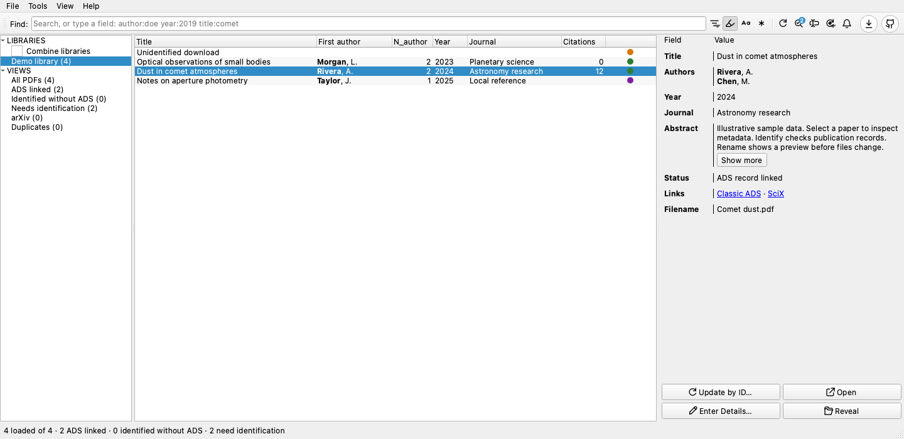

# ADSfolio

A desktop app and Python toolkit that organizes your research PDFs with NASA
ADS / SciXplorer, Crossref, and DataCite metadata. ADSfolio is an independent
project, not an official ADS application.

ADSfolio uses the official [NASA ADS API](https://github.com/adsabs/adsabs-dev-api)
for searches, citation exports, metrics, ADS libraries, and journal information.
We thank the ADS team for providing these services and their API documentation.



## Install

- **Desktop app:** download the file for your system from the
  [latest release](https://github.com/ysBach/adsfolio/releases/latest).
- **Homebrew on macOS:** `brew install --cask ysBach/adsfolio/adsfolio`
- **CLI and Python API:** `pip install adsfolio`. This installation omits Qt
  and the desktop bundle. Use `uv tool install adsfolio` for an isolated CLI.
- **Python with desktop features:** `pip install "adsfolio[full,gui]"`.

For AI agents, download the brief
[CLI/API skill](https://github.com/ysBach/adsfolio/releases/latest/download/adsfolio-cli-api-SKILL.md).
Save it as `adsfolio-cli-api/SKILL.md` in your agent's skills directory.
The [source skill](skills/adsfolio-cli-api/SKILL.md) is also available in this repository.
Search supports structured output:

```sh
adsfolio search 'author:Einstein' --fields bibcode,title,year --rows 5 --json
```

ADS searches require an ADS token. See [CLI and Python](https://ysbach.github.io/adsfolio/docs/command-line-and-python.html) for setup and API examples.

The app is not signed. Your system can ask you to approve it the first time.
See [Getting started](https://ysbach.github.io/adsfolio/docs/getting-started.html#install)
for the steps.

## Daily workflows

- **Keep a BibTeX file for your paper:** export an ADS library as `.bib` for
  LaTeX or Overleaf.
- **Watch a folder:** ADSfolio identifies each new PDF and renames it when the
  PDF's own arXiv ID or DOI confirms the match.
- **Keep Identify defaults:** save ADS fallback and provider choices for all
  libraries or one library.
- **Make your CV:** write your publication list in LaTeX, HTML, Markdown, or
  your own format.
- **Find a paper fast:** type `author:doe year:2019`, or plain words. A list
  suggests fields and author names, and the table highlights the matches.

See the [daily workflows](https://ysbach.github.io/adsfolio/docs/workflows.html)
with screenshots and a video.

## Documentation

- [Website](https://ysbach.github.io/adsfolio/)
- [Getting started](https://ysbach.github.io/adsfolio/docs/getting-started.html)
- [App GUI guide](https://ysbach.github.io/adsfolio/docs/gui.html)
- [CLI and Python](https://ysbach.github.io/adsfolio/docs/command-line-and-python.html)
  and the [API reference](https://ysbach.github.io/adsfolio/docs/api/index.html)
- [Changelog](https://github.com/ysBach/adsfolio/blob/main/CHANGELOG.md) and
  [issues](https://github.com/ysBach/adsfolio/issues)

## License

BSD-3-Clause. The desktop bundles include third-party components under their
own licenses. PyMuPDF uses AGPL terms. See
[Building the desktop app](https://ysbach.github.io/adsfolio/docs/desktop.html)
for details.
