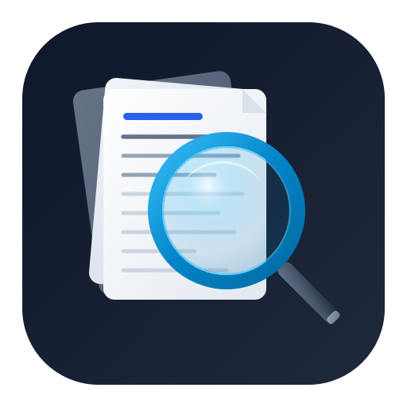
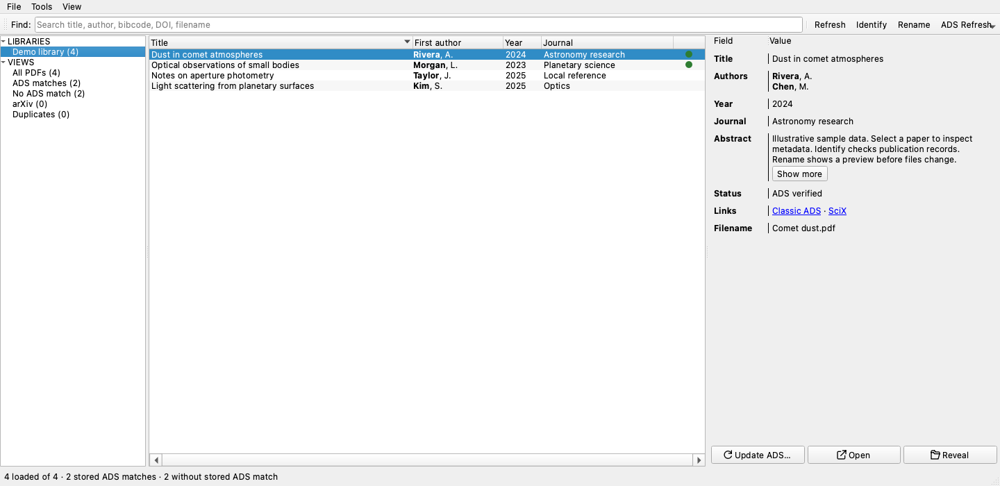

# ADSfolio

A desktop application and Python toolkit for organizing research PDFs with NASA
ADS / SciXplorer, Crossref, and DataCite metadata. ADSfolio is an independent
project, not an official ADS application.



## Start with the PDFs you already have

Add your existing PDF folder. Identify papers in a batch, inspect their metadata,
and preview useful filenames before you rename anything. You can keep your
current folder structure. You do not need to import PDFs into managed storage.

Identification checks saved results before online lookups. Lookup time depends on
PDF text quality, cache coverage, provider limits, and your connection. No fixed
speed claim applies to every collection. Start with one folder to check results.



*Application screenshot with illustrative sample data. Version 0.2.0 shown.*

[Website](https://ysbach.github.io/adsfolio/) · [First-library tutorial](docs/getting-started.md) · [Application guide](docs/gui.md)

## Install the desktop app

Download [ADSfolio 0.2.0](https://github.com/ysBach/adsfolio/releases/latest).
macOS downloads include DMG installers and ZIP archives.
Desktop downloads include Python and the application dependencies. You do not
need a Python environment or an ADS token to browse your local library.

| System | Download and open |
| --- | --- |
| macOS 15+, Apple Silicon | Open `adsfolio-macos-arm64.dmg`, drag `ADSfolio.app` to Applications, then open it. |
| macOS 15+, Intel | Open `adsfolio-macos-x86_64.dmg`, drag `ADSfolio.app` to Applications, then open it. |
| Windows x86-64 | Extract `adsfolio-windows-x86_64.zip`, then open `adsfolio.exe` inside the extracted folder. |
| Linux x86-64 | Extract `adsfolio-linux-x86_64.tar.gz`, then run `adsfolio` inside the extracted folder. Requires glibc 2.39+ and system desktop libraries. |

Keep the complete extracted folder together on Windows and Linux.
See the [platform requirements](docs/desktop.md) for details.

### macOS with Homebrew

```sh
brew install --cask ysBach/adsfolio/adsfolio
open -a ADSfolio
```

**Version 0.2.0 is unsigned and not notarized.** macOS can block opening even
when Homebrew installation succeeds. After attempting to open ADSfolio, review
**System Settings → Privacy & Security → Open Anyway** if macOS offers that
option. Approve it only if you trust the release. Installation alone does not
establish that the app can open. Windows can also show publisher warnings.

### Start using your library

1. Open ADSfolio. Choose **File → Add Library Root…** and select your PDF folder.
   To include nested folders, enable **Include Subdirectories** on the root.
2. Select a PDF to inspect or edit its metadata. Double-click a row to open it
   in your system PDF viewer.
3. Use **Identify** to look up publication metadata. Configure your ADS token
   through **Tools → NASA ADS Token…** when you need ADS services. Crossref and
   DataCite can look up DOIs without an ADS token. Choose provider order in Identify.
4. Preview **Rename** before applying filename changes. Papers with sufficient
   metadata can be renamed without an ADS bibcode. Use **File → Local References…**
   for manual entries and BibTeX import/export, including references without PDFs.
5. Press **Refresh** or **F5** after moving or deleting files outside ADSfolio.
   This reconciles local files. Use the separate ADS refresh actions to update
   remote metadata. Permanent cleanup remains a separate operation.

See the [interactive application guide](docs/gui.md) for watching folders,
selection, metadata editing, notifications, and refresh options.

### Updates and existing libraries

Quit ADSfolio before replacing the app, or run `brew upgrade --cask adsfolio`.
The catalog, metadata, and history live in your user data directory, outside the
application bundle. Retain that directory when upgrading or uninstalling.

Earlier settings and catalogs are copied into ADSfolio storage on first use.
The source remains intact. Close the earlier application before migration and
keep its data until you check the migrated library. Saved automatic watch and
rename settings remain active, so review them before resuming library work.

## CLI and Python

ADSfolio also provides search, bibliography export, and scripted PDF workflows.
See the [CLI and Python workflows](docs/command-line-and-python.md),
[CLI tutorials](docs/cli-tutorials/index.md), and [API reference](docs/api/index.rst).
PyPI publication is not enabled. Source installation requires Python 3.10 or newer.

## License

BSD-3-Clause
