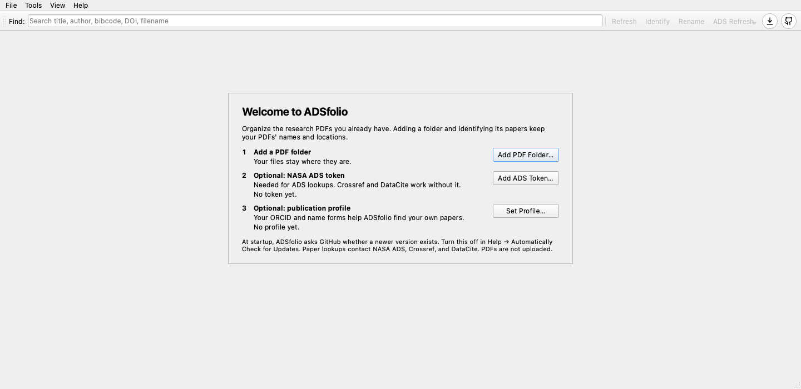
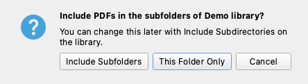
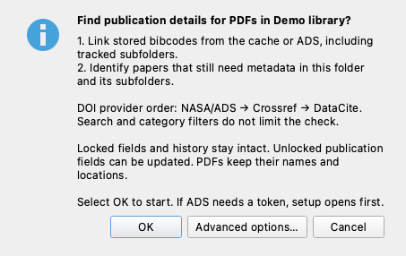

# Start with your PDF library

Install a [desktop download](https://github.com/ysBach/adsfolio/releases/latest).
Python is included. See [desktop installation](desktop.md) for platform limits
and unsigned-app approval.

## Watch the first run

<video controls muted playsinline preload="metadata" width="100%"
  poster="_static/welcome.png">
  <source src="_static/tutorial/first-run.mp4" type="video/mp4">
</video>

The 28-second video shows these steps with fictional sample papers:

1. A new installation opens with three setup steps.
2. **Add PDF Folder…** selects a folder of papers.
3. ADSfolio asks whether to include subfolders.
4. **OK** in the Identify prompt finds publication details.
5. The library lists papers and their details.

It ends with the optional token and profile windows and **Software Update**.

## Add your existing folders

1. Open ADSfolio. A new installation shows **Welcome to ADSfolio** with three
   steps. Only the PDF folder is required.
2. Choose **Add PDF Folder…** (or **File → Add Library Root…**).
3. Select your PDF folder.
4. If the folder has subfolders, choose **Include Subfolders** or
   **This Folder Only**. You can change this later with **Include Subdirectories**.

Adding a root records file locations. It does not move your PDFs.
The identification prompt opens next. Choose **OK** to start, or **Cancel** to
browse first.
You can browse your library without an ADS account.
Start with one folder before processing a large collection.

## Identify papers in a batch

1. Open **Identify**. Adding a folder also opens this prompt.
2. Read the lookup scope and choose **OK**.
3. Enter an ADS token if setup appears.
4. Review the results and job log.

The token window opens only when ADS needs a token. **Test Token** sends one
search request to ADS and shows whether ADS accepts the token.

Select **Advanced options…** to change evidence sources or DOI provider order.
The lookup keeps filenames and file locations. Locked fields and history stay
intact. Identification can update unlocked publication fields.

Identification checks saved results before online lookups.
The default provider order is ADS, Crossref, then DataCite.
Crossref and DataCite look up exact DOIs without an ADS token.
ADS title searches require your token.
Set it through **Tools → NASA ADS Token…** when requested.

Processing time depends on PDF text, cached results, provider limits, and your
connection. Scanned PDFs may need external OCR first. ADSfolio does not bundle OCR.
OpenAlex and PubMed lookup are not supported.

## Review metadata before renaming

A bibcode identifies a publication. It does not prove that the current PDF
matches that publication. Stored citation fields can remain available while
file verification is pending. Inspect the status tooltip for the reason.

1. Select a paper and inspect its metadata.
2. Correct fields when necessary.
3. Open **Rename**.
4. Review the filename preview.
5. Apply the changes you accept.

Papers with sufficient metadata can be renamed without an ADS bibcode.
Use **File → Local References…** for manual entries or BibTeX imports.
See [references outside ADS](local-references.md).

## Keep the library current

Press **F5** after moving or deleting files outside ADSfolio.
Local refresh reconciles file facts. ADS refresh retrieves remote metadata.
Permanent cleanup is separate.

The catalog stores metadata, file locations, and version history outside the app.
Replacing the application does not delete that catalog.
Close the earlier application before first-use migration.
Keep its original data until you check the migrated library.

See the [application guide](gui.md) for settings and folder watching.
See [CLI and Python workflows](command-line-and-python.md) for scripts and APIs.
