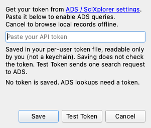
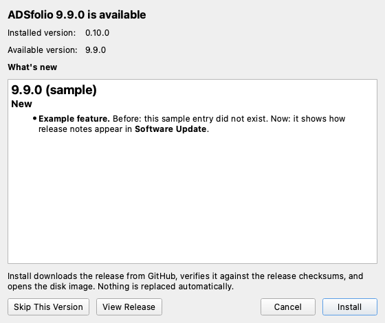
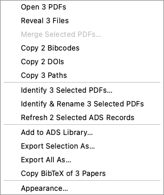
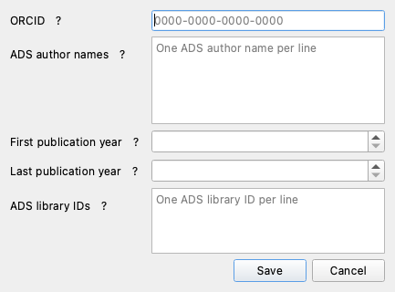
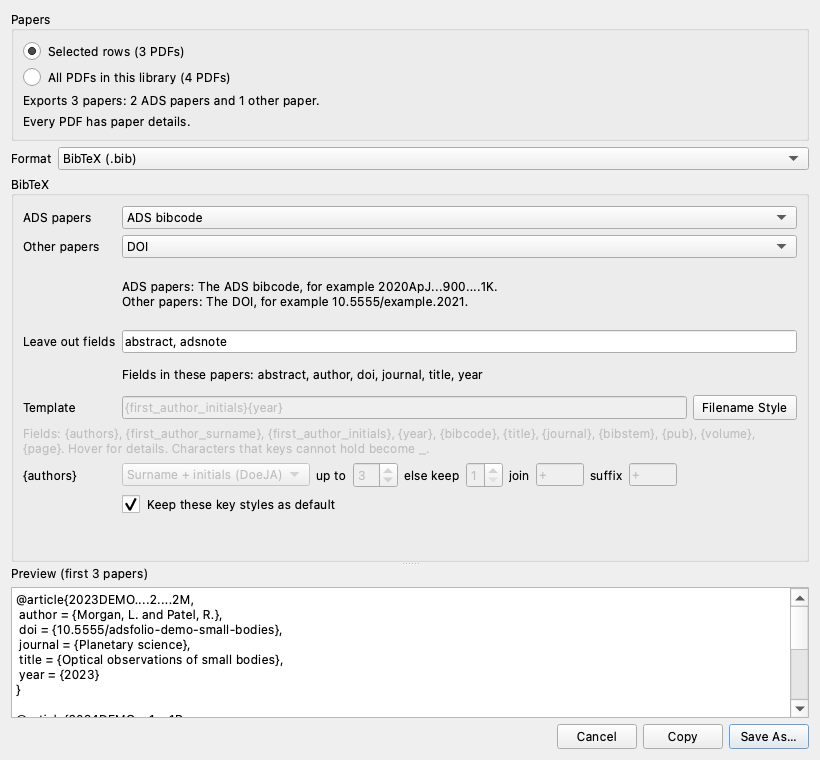
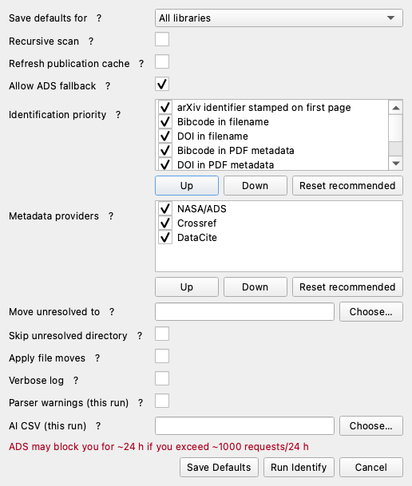
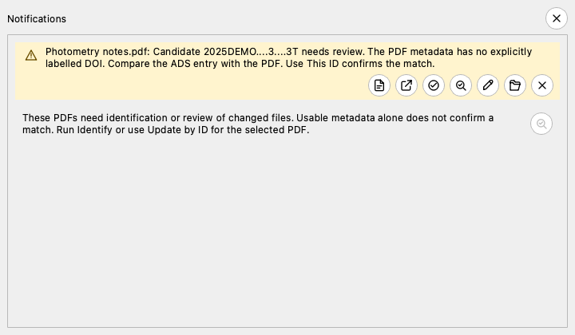

# App GUI guide

[Install ADSfolio](getting-started.md#install), then open it from your applications.
The download includes Python and the application dependencies.
ADSfolio provides a graphical desktop application to browse, catalog,
and organize scientific PDF libraries. To run it from a source checkout, see
[CLI and Python](command-line-and-python.md#from-source).

Startup does not require an ADS token. You can browse and edit local libraries
offline. ADS operations request a token when needed.

**Tools → NASA ADS Token…** shows where the active token comes from: the
`ADS_API_TOKEN` environment variable or a token file path. **Save** stores the
token in a file that only your user account can read. Saving makes no network
request. **Test Token** sends one search request to ADS. It reports whether ADS
accepted the pasted token. If the field is empty, it reports the result for the
active token.



Identification supports ADS, Crossref, and DataCite in that default order.
Reorder or disable providers in the Identify dialog. Crossref and DataCite
look up exact DOIs without an ADS token. Title matching uses ADS.
Declining ADS requests does not disable the other enabled DOI providers.
OpenAlex, Web of Science, and PMID/PubMed lookup are not supported.

The left pane lists library roots and filtered views. The middle pane shows a
searchable publication table. The right pane shows editable metadata for the
selected PDF.

## Search the table

Type in the **Find** field. Spaces separate the search terms. The table
shows PDFs that match every term. Put a phrase in double quotes to keep it
together, for example `"comet nucleus"`.

### Search one field

Type a field name, a colon, and the text, for example `author:doe`.

| Field | Searches |
|---|---|
| `author:` | All authors |
| `first_author:` | The first author |
| `title:` | Title |
| `year:` | Year |
| `journal:` | Journal name and abbreviation |
| `abstract:` | Abstract |
| `bibcode:` | Bibcode and alternate bibcodes |
| `doi:` | DOI |
| `identifier:` | Other identifiers, such as arXiv IDs |
| `filename:` | Path of the PDF in its library |

Example: `author:"Dorémont-Roe" year:2026 comet`.

While you type, a list suggests field names. For example, `f` suggests
`first_author:` and `filename:`. After `author:`, `first_author:`,
`journal:`, or `year:`, the list suggests values from the library. Press
**Return** or click a suggestion to insert it.

### Choose the default fields

A term without a field name searches all fields: the path, every metadata
value, and the content digest. To search fewer fields:

1. Click the **Search Fields** button next to the Find field.
2. Check the fields to search.

Choose **All Fields** to search everything again. Terms with a field name
are not affected.

### Search options

The Find bar has three toggle buttons. Hover over a button to read its name.

- **Highlight Matches** marks the found text in the table. It is on by default.
- **Exact Match** matches accents and letter case exactly. By default, search
  ignores both, so `doremont` finds `Dorémont`.
- **Wildcards** reads `%` as any text and `_` as any one character. By
  default, `%` and `_` match only themselves, so `3I_ATLAS` finds only an
  underscore. A wildcard does not cross from one field to another.

ADSfolio saves the options and the default fields for the next start.
Searches read only stored metadata. PDF text, such as acknowledgments, is
not searched.

## Settings

Press **⌘,** on macOS, or choose **File → Settings…**. On macOS, Settings
appears in the application menu. The window groups the desktop settings:

- **General** and **Appearance** control sounds, updates, panels, and columns.
- **Sorting** selects the sort column, direction, and tie-break columns.
- **Libraries and Watching** controls each library's watch and scan settings.
- **Identify and Rename** edits global defaults and library-only overrides.
- **Citations**, **Account**, and **CV and Export** contain the remaining settings.

Select **Save** in each section to keep its changes. Library watching controls
apply immediately. Closing Settings discards unsaved edits in the other sections.
The Appearance section applies its changes when you select **Save Appearance**.

For library-only Identify or Rename defaults, choose a library first. Stop its
watcher in **Libraries and Watching** before you save the defaults. Start the
watcher again afterward if needed. Saving defaults does not identify or rename
PDFs. In the combined view, choose the library explicitly.
If you change defaults, save them before you change the library or scope.
Otherwise, ADSfolio asks whether to discard them.

The CV section saves settings without generating a publication list. If its file
changes outside Settings, reopen Settings before saving. If it cannot load the
file, correct the file and reopen Settings. Token testing sends a request to ADS
only when you select **Test Token**.

## Version information and updates

Open **Help → About ADSfolio** to see the version, copyright, license links,
and installation type. On macOS, **About ADSfolio** appears in the application menu.
**Copy App Details** copies version and system information for a bug report.
It does not copy your library data or paths.

**App Update** in the toolbar opens **Software Update**. The round GitHub button
next to it opens the project page. A blue dot on **App Update**
means a newer stable release is available. **Help → Check for Updates…** opens the
same window and checks the latest stable GitHub release in the background.

Software Update shows the installed and available versions and the changelog
entries between them. It offers these buttons:



- **Install** (desktop downloads) downloads the release for your system from
  GitHub. It verifies the file against the release's `SHA256SUMS.txt` and saves
  it in your Downloads folder. Then it opens the disk image on macOS, or shows
  the archive in your file manager. ADSfolio does not replace anything
  automatically. Quit ADSfolio before you replace the application. **Cancel**
  stops a download and removes the partial file.
- **Copy Command** (Homebrew installations) copies `brew upgrade --cask adsfolio`.
- **Skip This Version** hides the dot and startup notice for that release.
  A newer release appears again.

Python and source installations show update instructions instead of **Install**.

The checksum detects damaged or incomplete downloads. It comes from the same
GitHub release, so it does not prove who published the file. On macOS, files
that ADSfolio downloads do not receive the quarantine flag that browsers add.
As a result, Gatekeeper may not prompt as it would for a browser download.

ADSfolio also checks once at startup by default. To disable this, use
**Help → Automatically Check for Updates**, or use the checkbox in About.
Startup checks show a notice only when a newer release is available.
They do not interrupt work when you are offline or already use the latest version.

GitHub receives your IP address and app version. Checks send no PDFs, library
metadata, or ADS credentials. ADSfolio does not install updates automatically.
Update checks do not change your metadata or history.

Use the update method for your installation:

- **Desktop download:** install the release for your operating system.
- **Homebrew:** run `brew upgrade --cask adsfolio`.
- **Python installation:** update the package or source checkout, then restart.
- **Local source launcher:** update its checkout, then restart ADSfolio.
  Its version label does not track individual source edits.
  A desktop installer or Homebrew upgrade replaces the source launcher.

The **Local source launcher** explanation appears only when the source launcher
sets `ADSFOLIO_SOURCE_LAUNCH=1`. Official desktop bundles show installation guidance
for their operating system instead. The About copyright shows `@ysBach`.

## Library roots and missing PDFs

Add a root from **File → Add Library Root…**, or from **Add PDF Folder…** on the
welcome page that appears while no library exists. The welcome page also offers
the optional ADS token and publication profile. It also lists the services that
ADSfolio contacts. Registration discovers PDFs immediately. When the selected
folder has subfolders, ADSfolio asks **Include Subfolders** or **This Folder
Only** (the default). When the folder has no subfolders, ADSfolio adds it
without a question. ADSfolio then asks how to watch the new library:
**Watch, Identify, and Rename**, **Watch and Notify Only**, or **Do Not Watch**
(the default). See [Watching library roots](#watching-library-roots).

### Combine libraries in one view

1. Show the **Libraries** sidebar from the **View** menu.
2. Check **Combine libraries** under **LIBRARIES**.
3. Check the libraries to include in the table.
4. Expand a library group and its nested folder groups as needed.
5. Select one PDF.

Each checked library appears as a collapsible folder group. Its subfolders
appear as nested groups. Each PDF shows the system PDF icon and starts under
its folder icon. The filename tooltip shows its library and full path.
Search, sorting, and views use the checked libraries. The combined view does
not move PDFs. Existing watchers keep running.

Right-click a field in the details pane to edit it or change its lock. Choose
**Enter Details…** to enter metadata manually. Choose **Update by ID…** to find
metadata for an identifier. These actions use the PDF's owning library. You
stay in the combined view. You can also open or reveal the selected PDF.

To identify selected PDFs, right-click them and choose **Identify Selected
PDFs…**. The selection must belong to one library. You can also choose
**Identify & Rename Selected PDFs** to apply its saved Rename settings.

**Update by ID…** may rename the PDF using its library's Rename settings. It
may also move a resolved PDF from the unresolved folder to its library root.
See [Identify and Rename](#identify-and-rename) for the rename conditions and
recovery steps. Some attachments share catalog metadata. An edit may change
information shared with other attachments.

During an automatic ADS recheck, select one PDF and choose **Update by ID…**
or **Enter Details…**. The app stops the recheck before it edits that PDF.
It waits for the current check to stop, so the action may not start immediately.
If the PDF or its catalog entry changes during the wait, the app cancels the
edit. Refresh the library and try again.

Other editing controls remain unavailable during the recheck. An active job
can also disable editing. Hover over a disabled control to read its reason.
The status bar shows the name of the running job, for example
"Automatic identifier recheck of Papers". A blocked action names the same job.
Wait for the job or recheck to finish, then retry the action. To stop the job,
click **Cancel** in the status bar, or choose **Tools → Cancel Current Job**.
A cancelled recheck keeps the failures that it found before it stopped. Start a
watcher after the active job or recheck finishes. **Combine libraries** also waits for the active job.

If another process changes a field you edited, the save stops. Reopen the
dialog and review the current value before you retry.

To run **Identify** or **Rename** for a whole library:

1. Right-click the library folder in the combined table.
2. Choose **Identify Library…** or **Rename Library…**.

To add PDFs to an ADS library from the combined view:

1. Select PDFs from one library.
2. Choose **Tools → Add to ADS Library…**, or right-click the selection.

If the selection contains PDFs from two or more libraries, the action is
unavailable. Its tooltip gives the reason. **Export Selection As…** accepts
PDFs from several libraries. **Export All As…** exports every current PDF in
the checked libraries.

Some **Tools** items apply to one library only. Examples are **Merge
Annotations…**, the ADS refresh items for all records, and the watch settings.
These items are unavailable while **Combine libraries** is checked. Hover over
an item to read its reason. Clear **Combine libraries** to use them.

**Show in Library** opens the owning library with the PDF selected. Clear
**Combine libraries** to return to one library.

If a checked folder is unavailable, **Notifications** names the folder. Reconnect
the folder and choose **Refresh** to reload the combined table. Combined refresh
reads the catalog. To scan a folder for new or missing PDFs, clear **Combine
libraries**. Select the library. Choose **Refresh**.

To change the scope later:

1. If ADSfolio watches the root, stop the watcher. ADSfolio disables the
   **Include Subdirectories** checkbox while it watches that root.
2. Right-click the root under **LIBRARIES**.
3. Toggle **Include Subdirectories**. This saves the scan scope, but it does not
   rescan the current catalog immediately.
4. Press **Refresh** (**F5**) to scan the root with its updated
   **Include Subdirectories** setting.

Non-recursive discovery updates only top-level locations. Previously cataloged
nested files remain unchanged, including their missing status. To restore
existing nested files and discover new ones, enable **Include Subdirectories**
and press **F5**.

For citations without ADS records or PDFs, use **File → Local References…**.
That window imports BibTeX, accepts manual entries, links optional PDFs, and
exports ADS and external references together. It is independent of the selected
PDF root. See [My paper is not on ADS](local-references.md) for the complete flow.

ADS remains the primary identification service. The sidebar separates three groups:

- **ADS linked** contains current saved ADS links.
- **Identified without ADS** contains current verified or user-confirmed identities without ADS links.
- **Needs identification** contains unidentified PDFs, unconfirmed metadata, and changed files that need review.

The status bar uses these groups. The Identify badge counts only **Needs identification** across the whole selected library.
Verified DOI records do not increase that badge. They retain normal table text and a purple status marker.
A stored bibcode can exist before ADSfolio links the file to its ADS record.
Metadata readiness remains separate from identity evidence.
An ADS link alone does not prove that the PDF contains the correct paper.
Open **Notifications** in the toolbar for help with the selected group.
The explanation does not change the main panes' positions.

The table and detail pane check for changed PDFs before they show verification.
A stored bibcode can remain visible after a PDF changes.

The watcher and Identify first check saved proof and cached provider metadata.
If a saved candidate remains unverified, they fetch its exact ADS record automatically when ADS is enabled and available.
Matching PDF identifiers establish verification without an approval click.
Only cases that remain unverifiable need review or retry.
Status tooltips explain changed files, ADS links, and metadata readiness.
External references can be ready for renaming without an ADS link.

**All PDFs** includes current catalog locations. Queries exclude missing locations.
In a single-library view, press **F5** to reconcile files moved or deleted
outside ADSfolio.
Double-click a bibcode, arXiv ID, or filename to open its destination by default.
If you prefer single-click activation, choose it in **View → Appearance… → Applications**.
Use the context menu to reveal a file or copy an identifier.

In a single-library view, select several rows with **⌘**-click or
**Shift**-click (**Ctrl** on Windows and Linux). Right-click the selection.
The context menu offers these actions:

- **Open N PDFs** and **Reveal N Files** (one file manager window per folder).
- **Copy N Bibcodes**, **Copy N DOIs**, and **Copy N Paths** copy one value per
  line. Each copy omits rows without the value, and the tooltip gives the count.
- **Identify N Selected PDFs…** identifies only those files.
  **Identify & Rename N Selected PDFs** runs both steps with saved settings.
  **Refresh N Selected ADS Records** refreshes each paper with a bibcode.
  **Update and Rename Selected by Identifier…** needs one row, because it asks
  for one identifier.
- **Add to ADS Library…** adds the selected papers to an ADS library.
- **Export Selection As…** opens [Export Papers](#export-papers) with the
  selected rows. **Export All As…** opens it with every current PDF in this
  library. **Copy BibTeX** copies the selection's BibTeX at once.



To identify and rename in one run, use a single-library view:

1. Select the PDF rows.
2. Right-click and choose **Identify & Rename Selected PDF** or its multiple-file equivalent.

This action starts immediately. It uses the saved Identify and Rename scopes
for the current library. Saved ADS fallback permission still applies. The
job log reports metadata results and filename changes.

Unverified files and existing destinations keep their paths. PDF contents
remain unchanged. A failed command or cancellation stops the remaining step.
For a skipped file, review its job-log message before trying **Update by ID…**.
To preview filenames separately, use **Tools → Rename…** after identification.

## Browsing files and editing metadata

The table loads records in pages to keep large libraries responsive. The status
bar reports the loaded and total counts. Scroll or use **File → Load Next Page**
to load another page.

Bibcode and arXiv columns link to ADS and arXiv, respectively. Double-click a
cell to open its link, or choose single-click activation in the Appearance
dialog. ADSfolio never treats a click that only selects or edits as activation.
If a link column is too narrow for its full value, it shows a compact branded
link badge. Its tooltip and accessible text keep the full value. The Filename
column follows the configured activation and action: open the PDF or reveal it
in the file manager.

Right-click the table header to:

- align the selected column to the left, center, or right.
- show or hide columns.
- show all columns.
- resize columns to their contents.
- restore the default column order.

Drag a column header to change its position. ADSfolio saves the order and
alignment immediately. Choose **Default** in the alignment menu to restore a
column's default alignment. If saving fails, Notifications reports the error.
The change remains active for that session.

**Added** appears immediately before **Modified**, and the default
sort places the most recently added files first.

Click a sortable column header to choose the primary sort. Click it again to
reverse the direction. ADSfolio saves the choice immediately and restores it
after restart. Search, library switches, and refresh keep the chosen sort.
Use **Settings → Sorting** to choose different columns for each tie-break. If
saving fails, Notifications reports the error. The sort remains active for
that session.

The narrow, unlabeled status column uses three dot colors:

- **Green:** an ADS record is linked.
- **Purple:** local or external metadata is ready for renaming, without an ADS link.
- **Amber:** the PDF still needs identification or metadata entry.

A changed PDF shows an amber warning triangle instead of a dot.
Tooltips and accessible text explain the state without relying on color.
An ADS link does not prove that the PDF contains the correct paper.
Click the status header to group records by their saved ADS status.

**N_author** shows the saved author count. **Citations** shows the saved citation
count. A blank count means unknown. A known citation count of zero appears as
**0**. These counts come from saved metadata or manual edits. They are snapshots,
not live ADS queries. Use the header menu to hide either column.
The table uses each PDF's saved citation count. Separate citation metrics in
the detail pane can come from a different refresh.

Use **View → Appearance…** to:

- choose a fixed-width font and point size independently for each table column.
- configure right-pane metadata text.
- select ISO 8601 or any Python ``strftime`` timestamp format, for example
  ``%Y-%m-%d``. Month is lowercase ``%m``.

The toolbar uses compact icons for **Refresh**, **Identify**, **Rename**, and
the **ADS Refresh** menu. Hover over an icon for its action and scope.
The menus retain text labels and keyboard shortcuts.

The Identify badge counts catalogued PDFs that need an ADS lookup across the
selected library. Search, category filters, selection, and pagination do not
limit this count. It does not predict successful matches or the exact number
that Identify will process. Identify can discover untracked PDFs and skip
records whose metadata is already ready. It can also skip the configured
unresolved folder. The badge can therefore remain above zero after identification.

In a single-library view, use the toolbar **Refresh** icon or **F5** after you
add, edit, move, or delete PDFs outside adsfolio. Refresh scans the selected
root with its **Include Subdirectories** setting. It runs locally in a
background job. It updates changed file facts and discovers new PDFs. It hides
missing paths but keeps their catalog history. **File → Reconcile File Facts…**
runs the same scan.

Refresh preserves existing metadata and local edits. Moved files retain their
metadata when their filesystem identity matches. The status bar and job log
report added, modified, moved, restored, and missing counts. Refresh keeps
selection, search, and sort settings when the originating view is still active.
Watcher writes pause during the scan.

The toolbar **ADS Refresh ▾ → Look Up Stored Bibcodes…** repairs pending ADS
links. It uses cached records first and queries uncached bibcodes in batches.
It fills empty metadata fields and retains existing values, locks, and history.
PDFs stay in place.

After a PDF changes, Rename can check its saved bibcode against the cached ADS
record. The watcher and automatic ADS recheck can also check the current PDF.
When verification succeeds, ADSfolio restores the record without changing the
PDF contents. If verification fails, the job log gives the reason. Use
**Identify papers…** or **Update by ID** to review the record.

Other ADS Refresh actions refresh and rename the selected record, a manually
entered identifier, all stored bibcodes, or citation splits. They use saved Rename
settings. **Refresh and Rename All ADS Records…** also includes eligible pending
bibcodes. A local **Refresh/F5** reconciles file facts without querying ADS.

Hold **Shift** to scroll the table horizontally. Each mouse-wheel event moves
at most one tenth of the visible page. Smooth trackpad movement uses one tenth
of its pixel distance. The same speed applies over the table header and scrollbars.
Discrete horizontal mouse-wheel scrolling without Shift also uses at most one
tenth of the visible page. Smooth trackpad movement and vertical scrolling
without Shift keep their native behavior.

Permanent cleanup remains separate: **File → Remove Missing Registry Records…**
asks before removing missing catalog entries and never deletes files.

Drag metadata rows in the right pane to choose their order. ADSfolio
keeps the order the next time the app starts. **View → Appearance… → Details** also lets
you reorder rows and choose which ones appear. Click a value to copy it. The
tooltip and status-bar message report the copy without changing the row layout.

Appearance changes apply immediately to the main table and detail pane while
the dialog is open. **Cancel** restores the previous appearance. **OK** keeps
the live settings for normal configuration saving.

**View → Appearance… → Applications** controls:

- whether bibcode, arXiv, and filename cells activate on double-click (default)
  or single click.
- whether filename activation opens or reveals files.

It also accepts optional PDF-viewer and web-browser commands. Empty commands use
the operating system defaults.

Right-click a bibliographic field to edit it or change its lock. A lock
preserves that field through later ADS updates, including **Identify** and
explicit refresh. ADS replaces unlocked fields. File identity fields
(filename, full path, modified date, size, and SHA-256) and workflow-state fields
(status and identification time) remain read-only.

Long author lists show five names first and expand on demand. Long abstracts
start as a preview and expand inline with **Show more**.

ADSfolio hides upgrade and annotation-port audit fields by default. The default
order places bibstem, volume, and page at the end, because the bibcode encodes
that information. ADSfolio converts HTML display markup from ADS to plain text
in the table, detail pane, and generated filenames.

Click a PDF's status marker to select that file and reveal the right detail
pane, including when the pane is hidden or collapsed. The pane shows the
file's status and offers **Update by ID…** and **Enter Details…**. Modified
clicks retain the usual table selection behavior.

Use **Update by ID…** in the detail pane to enter or correct the
selected file's Bibcode, DOI, arXiv ID, or bibliographic reference. Use either
reference format:

* `{authorLastName}-{year}-{bibstem}`
* `{bibstem}-{volume}-{page}`

| Field | Meaning |
| --- | --- |
| `{authorLastName}` | Last name of an author of the paper. |
| `{year}` | Four-digit publication year. |
| `{bibstem}` | ADS journal abbreviation, such as `Natur` for *Nature*. |
| `{volume}` | Journal volume number. |
| `{page}` | Starting page or article number, such as `42` or `A113`. |

You can replace `{bibstem}` with the full journal name in either format.
For example, `Last-2020-Natur` specifies author Last, year 2020, and journal
*Nature*. `Sci-123-45` specifies the journal *Science*, volume 123, and
starting page 45. These illustrate the input format. `Last-2020-Nature`
and `Science-123-45` use the full journal names instead.

Reference hints search ADS. An author can be a coauthor of a different paper.
If several papers match, select the correct paper. If the PDF has no trusted
identifier, select the returned paper before the update. If the PDF or the
selected record changes during that review, retry **Update by ID…**.

If a journal-name search finds no result, ADSfolio retries without the English
word `the` in the journal name. It preserves the other reference fields. If
you disable ADS, use a DOI or enable ADS to search a reference hint.

If no ADS candidate matches the reference, enter a DOI or Bibcode instead.
The app does not replace your reference with an identifier from the PDF.

Spaces and underscores can also separate the reference fields. Author and
journal names can contain spaces or hyphens. A numeric volume and page take
precedence over the author-year format. If multiple ADS records match,
ADSfolio lets you choose the correct paper before updating the PDF.

Typing a DOI, Bibcode, or arXiv ID starts the lookup without a separate
confirmation about missing PDF metadata. When a PDF identifier conflicts,
the app shows that identifier and the returned paper. Check the paper and
confirm only if you want to use that result. Cancel keeps the current metadata.
The confirmation applies only to the reviewed PDF and record. If either changes,
retry the lookup. Automatic identification still rejects conflicting identifiers.
An identifier update replaces unlocked identity fields with provider values.
It keeps notes and locked fields. If a locked identifier conflicts, unlock or
correct that field and retry the update.

A DOI may be bare,
`DOI:`-prefixed, or an HTTP(S) `doi.org` / `dx.doi.org` link. ADSfolio does not
recognize other publisher URLs. ADSfolio uses a DOI exactly as typed (apart from
lower-casing). As a result, it keeps trailing punctuation or parentheses that
belong to the DOI. Remove any sentence punctuation that you pasted with the DOI.

**Update by ID…** refreshes that file's unlocked ADS metadata,
abstract, and citation counts. When it finds a unique matching ADS record, it
marks the file resolved. When ADS has no DOI or arXiv match, Crossref and
DataCite can supply the metadata without an ADS link. See
[My paper is not on ADS](local-references.md#type-the-doi-or-arxiv-id). It then renames the PDF with the selected global or library Rename
settings. When a provider verifies a PDF identifier without an ADS link, the
detail pane shows **Identified (no ADS link)**. The PDF appears in **Identified without ADS**.
User-confirmed identities also appear there, with a manual label in the detail pane.
For a confirmed conflict, the detail pane labels the identification as manual.
If the lookup fails, the app retains the existing metadata. Check the job log
and retry, or choose **Enter Details…**.

Use **Enter Details…** in the detail pane to type a title, authors, year,
journal, or DOI without an online lookup. **Save Metadata** saves changed fields
locally and locks them against provider updates. It preserves the PDF's name
and location. You can save partial metadata. A local entry does not mark the
paper as ADS linked.

**Tools → Refresh Selected ADS Record** performs the same update with the
current Bibcode, including detailed citation splits. **Tools → Refresh All ADS
Records…** refreshes metadata and abstracts for every tracked file with each
returned Bibcode. It preserves locked fields. **Tools → Refresh All Citation
Splits…** is deliberately separate, because ADS's Metrics endpoint returns
refereed/non-refereed counts only per paper. It confirms the number of
individual requests before it starts. Selecting a row does not by itself send
an ADS request.

**Tools → My Publication Profile…** stores your ORCID, ADS author-name forms,
first/last publication years, and optional ADS library IDs. The ORCID field
accepts an iD or an `https://orcid.org/` link. It checks the iD's check digit
before saving.

These global fields define the publications fetched for profile
matching. The years do not reject PDFs by their publication year. Saving the
profile does not make a network request. To rebuild the cache, use
**Tools → Identify → Advanced options… → Refresh publication cache**.



## CV Generator

**Tools → CV Generator…** makes a publication list for your CV from your NASA
ADS records. It writes LaTeX, HTML, Markdown, plain text, or any other text
format that you design.

1. **Your publications:** the ADS query, ORCID iD, years, and your name.
   **Fill from My Publication Profile** copies them from your profile.
   ADSfolio highlights your name in each author list.
2. **Format:** choose a built-in LaTeX or Markdown style, or **Custom
   template**. For a template, choose a starting point (LaTeX, Markdown, HTML,
   or Plain text), then edit the header, section, entry, and footer text.
   **Highlight your name** sets the markup around your name, for example
   `\textbf{{{}}}` in LaTeX or `<b>{}</b>` in HTML.
3. **Preview:** **Sample papers** shows fictional papers and updates while you
   type, with no network request. **Look Up in ADS** shows your real
   publications. **Show as** shows the exact file text (**Source**), or the
   text as a reader sees it (**Markdown** or **HTML**). LaTeX shows as source.
4. **Save CV** looks up your publications and writes the output file.

Hover over any control or label for an explanation. **Split into
First-authored and Co-authored sections** controls the two sections. Disable it
for one list in the original order.

ADS lookups need a token. The window stores its settings in `cv.yaml` in the
ADSfolio configuration folder. A script can repeat the run with the same file:
see [Tutorial 6](cli-tutorials/06-cv-workflows.md). **Save Settings As…** copies the
settings to another file. See the [CV reference](cv.md) for every template
placeholder.

### Export papers

**Export Papers** writes papers from this library as BibTeX, citation text, or
a publication list. All settings and a preview are in one window. It uses the
details stored in the catalog. Only BibTeX contacts ADS, once for each paper,
as **ADS BibTeX** below explains. Papers outside ADS export too, for
example papers that Crossref or DataCite identified, or details that you
entered.

1. Choose **Tools → Export Selection As…** or **Tools → Export All As…**.
   You can also right-click selected rows.
2. Under **Papers**, choose the selected rows, the rows in the current table
   view, or all PDFs in the library.
3. Choose a **Format**. The settings below the format change with it.
4. Check the preview of the first three papers.
5. Click **Copy** or **Save As…**.

The summary counts ADS papers and other papers. Several PDFs of one paper
export once. PDFs without paper details cannot export. The window counts
them, and **Show…** lists them. **Show Needs Identification** closes the
window and shows the PDFs to identify.

| Format | Settings |
|---|---|
| **BibTeX (.bib)** | Citation key style for ADS papers and for other papers, an optional key template, and the fields to leave out. **Keep these key styles as default** saves the key settings for later exports. |
| **Citation text (custom style)** | One of your [custom citation styles](#custom-citation-styles). Each paper gets one line. |
| **Publication list** | Your name and the list format, as in the [CV Generator](#cv-generator). The settings stay in `cv-selection.yaml`, so they do not change your CV settings. |

If BibTeX papers need a key that you type, or two papers share a key, ADSfolio
asks for the keys when you copy or save. The window remembers the last format.

#### ADS BibTeX

For an ADS paper, BibTeX export uses the entry from the ADS export service. So
a thesis exports as `@PHDTHESIS` with `school`, and every entry keeps `month`,
`keywords`, and `adsurl`. ADSfolio changes only the citation key and leaves
out the fields that you choose.

ADSfolio saves each entry in the catalog on this computer. Later exports read
the saved entry and make no network request.

1. Open **Export Papers** with BibTeX selected.
2. If some papers have no saved entry, the status line shows "Getting ADS
   BibTeX". **Copy** and **Save As…** wait until it finishes.
3. ADSfolio saves the entries. The preview then shows them.

A first export of about 3,000 papers takes about 20 s. ADSfolio requests an
entry again only after the ADS details of that paper change.

These papers use the details stored in the catalog instead:

- Papers outside ADS.
- Papers with a locked title, author, year, journal, volume, issue, page, DOI,
  or abstract. Your locked values stay in the export.
- Papers for which ADS returns no entry. ADSfolio saves this result too.
- Papers without a saved entry when ADSfolio cannot reach ADS or has no token.
  The status line names the cause.

#### Citation keys from a template

Choose **My template** as a key style, then type the template. The window
lists every field below the template. These fields are the same as for
[custom citation styles](#custom-citation-styles): `{authors}`,
`{first_author_surname}`, `{first_author_initials}`, `{year}`, `{bibcode}`,
`{title}`, `{journal}`, `{bibstem}`, `{pub}`, `{volume}`, and `{page}`.

The **{authors}** row sets how `{authors}` writes the names. It holds the
name format and the number of authors shown in full. It also holds the number
kept for a longer list, the text between names, and the text after a
shortened list.

**Filename Style** makes ADS keys like the default PDF filenames. It sets the
template to `{authors}_{bibcode}` with surname and initials joined by `+`:

| Authors | Key |
|---|---|
| Doe, John A. | `DoeJA_2021A&A...650A.123D` |
| Doe, John A. and Roe, Alice | `DoeJA+RoeA_2021A&A...650A.123D` |
| Four authors | `DoeJA+_2021A&A...650A.123D` |

A key cannot hold spaces, commas, braces, parentheses, quotes, `#`, `%`, `~`,
`\`, or `=`. ADSfolio replaces each of these characters with `_`. For papers
without a bibcode, choose another style under **Other papers**, because
`{bibcode}` is empty for them.

#### Leave out fields

Type the BibTeX fields to leave out, separated by commas. The default is
`abstract, adsnote`. The line below lists the fields that the chosen papers
hold. Clear the list to export every field. ADSfolio keeps the list for the
next export.



## Custom citation styles

Edit custom citations from the exact menu command
``Tools -> Custom Citation Styles...``. Qt shows it as **Tools → Custom
Citation Styles…**. The editor manages the ordered list of styles:

1. Select **Add** to create a new style with the next available ``My bibcode N``
   name. Or select a style and choose **Duplicate**. **Duplicate** inserts a
   copy with a fresh ID and a unique ``Copy of <name>`` name.
2. Select a style and use **Rename** by editing its **Name** field. Then edit
   its template and author controls.
3. **Reorder** styles with **Move Up** and **Move Down**. **Delete** removes the
   selected style. An empty list is a valid case.
4. Select **Update Preview** to validate the current draft and render it. If
   you opened the editor with exactly one selected table record, the preview
   uses that record. Otherwise the preview uses a labeled built-in example.
   Preview changes only the preview. It does not change the saved style list or
   the running library view.
5. Select **Save** to validate the current draft and the complete style list.
   A valid save immediately replaces the generated table columns and detail
   rows. It also persists the styles in the GUI configuration. Select
   **Cancel** to close without applying or emitting the draft changes.

On **Save**, invalid syntax, fields, names, IDs, duplicate names/IDs, or author
settings show an error and keep the editor open. The editor identifies the
affected style. It focuses a control only when one exists (IDs have no editor
field).

For each saved style, adsfolio creates a computed table column and detail row
after **Bibcode** by default, in the order shown in the editor. Generated
table columns are display-only and are not sortable. Generated detail rows are
computed, read-only, and not lockable. They do not become ADS metadata fields.

Use **View → Appearance…** to reorder or hide generated columns and detail rows.
You can also set their optional table/detail font, size, and color there. Use
**OK** in the Appearance dialog to keep those live settings for configuration
saving. **Cancel** restores the prior appearance. New generated items are
visible by default. These appearance settings, the style definitions, and their
order persist the next time the application starts.

Click a non-empty generated table cell or detail value to copy its complete
rendered text. The table status bar or detail tooltip reports **Copied**. An
empty rendered value is inert and leaves the clipboard unchanged.

Missing metadata supplies an empty string for its placeholder. The template's
literal spaces and punctuation remain. Rendering preserves Unicode. Rendering
is local-only and uses the record already available in the catalog or selected
row. Editing, previewing, selecting, and copying a citation do not send an ADS
request. Custom citation text is not a filename and does not rename PDFs.

Use Python-style replacement fields from this complete reference. Write fields
exactly as shown. When you save, the editor rejects format specifiers,
conversions, attribute/item access, unknown fields, and unmatched braces.

| Field | Rendered value |
| --- | --- |
| ``{bibcode}`` | ADS Bibcode, unchanged. |
| ``{year}`` | Publication year. |
| ``{title}`` | The first title value, with ADS HTML display markup converted to plain text. |
| ``{first_author_surname}`` | Surname of the first author only. For ``Doe, John A.`` this is ``Doe``. |
| ``{first_author_initials}`` | First-author surname followed by given-name initials. For ``Doe, John A.`` this is ``DoeJA``. |
| ``{authors}`` | The author list in the selected author format and separator. If the total exceeds **Max authors**, retain **Authors when truncated** leading authors and append the configured truncation suffix. |
| ``{authors_without_suffix}`` | The same rendered author list, but without the truncation suffix. |
| ``{journal}`` | The first ADS bibstem, falling back to ``pub`` only when bibstem is absent. |
| ``{bibstem}`` | The first ADS bibstem only. It has no fallback. |
| ``{pub}`` | ADS publication or journal text, rendered as plain text when ADS markup is present. |
| ``{volume}`` | Publication volume. |
| ``{page}`` | First page or article identifier. |
| ``{{`` and ``}}`` | Literal opening and closing braces. |

Missing values render as empty strings. Rendering preserves spaces,
punctuation, and Unicode. It does not append a ``.pdf`` extension. For example:

```text
{first_author_initials} ({year}) {bibstem}, {volume}, {page}
→ DoeJA (2024) A&A, 123, 456
```

Empty names, templates, and IDs, invalid author settings, duplicate names/IDs,
and invalid template syntax keep the editor open and identify the affected
style. The editor focuses a control only when one exists. IDs have no editor
field.

The author controls apply only when the template uses ``{authors}`` or
``{authors_without_suffix}``:

- **Author format**: **Surname + initials** (for example ``DoeJA``),
  **Surname only** (``Doe``), or **Last, First** (``Doe, John A.``).
- **Max authors**: the threshold. ADSfolio does not truncate a list at or below
  that count.
- **Authors when truncated**: how many leading authors remain above the threshold.
- **Author separator**: joins retained authors.
- **Truncation suffix**: ADSfolio appends it only to ``{authors}``, and only
  when truncation occurs.

For an author name without a comma, ADSfolio uses the last token as the surname.
It uses the preceding tokens as given names.

## Identify and Rename

**Tools → Identify** and **Tools → Rename** run the same CLI commands as the
terminal application, as subprocesses. Output streams to the log dock. After
completion, ADSfolio reloads catalog records so counts and metadata are fresh.
Rename shows a dry-run preview before it applies changes. The GUI does not
render PDFs itself.

**Preview** lists the PDFs whose names would change. Rename renders each new
name from the stored metadata first. It reads a PDF only when the name would
change, to check the PDF's identity before the rename. A PDF that already has
its name, or whose new name another file already has, is not read. The preview
runs in a separate process. **Cancel** or closing the window stops it. A
preview changes no files.

**Destination exists** means that another PDF already has the new name. This
is often a second download of the same paper. Rename never overwrites a file.
Compare the two PDFs, keep one, and then run Rename again.

**Identify…** opens a short explanation with **OK**, **Advanced options…**, and
**Cancel**. **OK** starts the lookup directly:

1. It checks pending stored bibcodes against the cache and ADS.
2. It then identifies PDFs that still need metadata.

The lookup retains locked fields and history. It can update unlocked
publication fields. Files keep their names and locations.

The bibcode step covers all tracked PDFs in the library, including tracked
subfolders. The identification step uses the library's subfolder setting and
retains the saved unresolved-folder exclusion. The prompt states these scopes
and the DOI provider order. View and search filters do not limit this library
check. The library's subfolder setting controls recursion. Saved evidence and
provider settings still apply.

If ADS needs a token, setup opens before the job starts. The result notice
shows ADS link counts and the next step. To rename PDFs, use **Rename…**
separately.

Adding a PDF folder offers the same prompt. The **Needs identification** view also
contains an **Identify papers…** button. Routine navigation does not open popups.

Select **Advanced options…** to open the full Identify dialog. This dialog
remembers reusable options after the app restarts. **All libraries** stores global
defaults and is the default selection. **This library only** stores portable
overrides in that library's catalog metadata. Switching the scope immediately
loads its values.

**All libraries** selects shared settings. To browse several libraries at once,
use [Combine libraries in one view](#combine-libraries-in-one-view).

The **Identification priority** list contains every supported evidence source.
Check the sources to enable. Drag them, or use **Up** and **Down**, to set
their order.

Identify tries the enabled evidence sources in order. DOI lookups use the
enabled providers in their configured order. If a candidate is missing,
invalid, or ambiguous, Identify tries the next source. The default order starts
with the first-page arXiv stamp. It then checks filename and metadata
identifiers before structured filenames and title matching. For an opaque
filename, Identify can continue to a DOI in the PDF.

A validated ADS match must also pass the [PDF identity check](#pdf-identity-checks).
A candidate that fails it leaves the PDF unresolved, and the job log states the reason.

### PDF identity checks

Before ADSfolio saves publication metadata for a PDF or renames it, it compares
the record with identifiers from the PDF. It reads the page-1 arXiv margin
stamp and DOI properties in DocInfo and XMP metadata.

A metadata title that contains only a labeled DOI or DOI URL also identifies
the PDF. A Subject DOI needs additional agreement: the first page must repeat
it, and the metadata title must match the provider title. These comparisons
ignore title case, whitespace, canonical Unicode differences, and curly versus
straight quotation marks. A spaced dash and a colon followed by whitespace
count as equivalent subtitle separators. Words, numbers, and other punctuation
must still agree. ADSfolio recognizes supported display markup in provider
titles during this comparison. A DOI mentioned in an ordinary title or a
reference does not establish identity.

A publisher article DOI also needs agreement with the provider and page 1.
Page 1 must contain the full provider title and exact DOI. The PDF metadata
title may omit dashes. Other title characters must still agree.

A PDF can state no DOI or arXiv ID at all. A scan of a paper from before DOIs
is an example. Such a PDF matches the provider record only when page 1 shows
all of these items:

1. The full provider title as the only text on its lines. Footnote marks,
   numbers, and punctuation can be next to it. Case, spacing, dash and
   quotation-mark styles, and words hyphenated at a line end do not matter.
2. The first author's surname as a whole word.
3. The publication year.
4. The volume and then the first page on one text line, for example
   "ICARUS 73, 462--481 (1988)".

A title inside a sentence, a reference, or a heading such as "Addendum:" does
not count. A DOI on page 1 that the provider record does not list stops the
match.

A correction notice repeats the original title and citation. So a page-1 line
that holds only Erratum, Errata, Corrigendum, Correction, Addendum, or
Retraction also stops the match. The notice then starts with a warning that
the PDF can be a correction notice. Open the PDF before you choose **Use This
ID**. If the PDF is the original paper, **Use This ID** is correct. After a page-1 match, the details pane shows **Identified from page 1
(ADS linked)**. Text recognition errors on page 1 can stop a correct match. In
that case, use **Use This ID** or **Update by ID**.

A displayed bibcode can be a lookup candidate that still needs verification.
If corroboration fails, the notice names the failed check. For example, it can
report that a DOI matches but the document titles differ. When a proposed ADS
record is available, choose **View ADS Entry** to open that exact record.
Choose **Open PDF** to inspect the local paper. Compare the title, authors,
year, and DOI. Choose **Use This ID** to confirm the displayed candidate
without typing its bibcode or answering another confirmation dialog.
This updates catalog metadata and applies your saved Rename settings.
Use **Update by ID** to choose a different record.
If the PDF identifier conflicts, review the returned record before confirming it.

The check has four outcomes:

- **Verified:** the provider's record (ADS, Crossref, or DataCite) lists every
  identifier of the proposed record and every arXiv ID and DOI that the PDF
  states. Identify, Rename, the watcher, and ADS refresh actions can proceed.
  A PDF with no identifier is also verified when its page-1 citation matches.
- **Identified from filename:** an exact filename bibcode has one ADS match,
  and readable PDF identifiers do not conflict with it. The details pane marks
  this source. The filename alone does not independently verify PDF contents.
  Check the paper and use **Update by ID** if the filename names another work.
- **Conflict:** the PDF states an arXiv ID or DOI, and the record has a
  different identifier of the same kind. Automatic actions refuse the change.
  Use **Update by ID** to review and confirm a different record for that PDF.
- **Unverified:** the PDF states an identifier the record lacks, or a required
  identity field is unreadable. A PDF without readable identifiers, an exact
  filename match, or a matching page-1 citation also remains unverified. Automatic actions leave it unchanged.
  Enter an exact identifier with **Update by ID** to choose the record.
  If the PDF states an identifier the provider cannot corroborate, review the
  conflict before confirming the result. ADSfolio stores that confirmation with
  the file's SHA-256 hash and the record's identifiers. A changed PDF or record
  needs a new check.

For an incremental annotation save, ADSfolio can preserve an existing
identification. It checks the earlier bytes and the PDF structure. The check
compares the underlying document. An annotation can cover page content. The
check keeps any previous verification level. It does not establish identity proof
for an older record without proof. If ADSfolio cannot establish continuity, it
checks the changed PDF again. Review the notice if that check cannot identify
the paper. A cached ADS record can also verify the current PDF and restore an
older stale record. ADSfolio retains the previous identity information as history.

Malformed optional XMP does not block a matching DOI from another metadata
field. ADSfolio also reads explicitly declared DOI properties when an unrelated
XMP property uses an undeclared prefix. It records the parsing issue as a
warning. Automatic identification requires readable identifiers to agree.
Use **Update by ID…** to review an explicit correction.

Identification updates the app's catalog. Renaming changes the file's name or
location. Neither action rewrites the PDF contents or repairs its metadata.

Content hashes, search result order, and title or author similarity do not prove
identity. A title search can propose a candidate, but the candidate must pass
the check. A unique exact ADS bibcode in the filename can associate a scanned
PDF without an identifier. That association remains distinct from verification
against the PDF. The check does not interpret scientific content.

Records identified by earlier versions have no stored identity proof.
ADSfolio checks them again against the current file before it renames them or
writes their metadata. A previously resolved PDF that fails the check keeps its
name, location, and stored metadata until you correct the record. If the PDF
states no own identifier, you can instead review and confirm the association.

**Save Defaults** saves the reusable controls for the selected scope. It does
not run Identify or close the dialog. **Run Identify** uses the controls as
currently displayed, without saving them. Parser warnings and the optional AI
CSV are one-run inputs. **Refresh publication cache** and **Apply file moves**
are one-run actions. They always reopen disabled.

If saving global defaults fails, ADSfolio keeps the existing setup file.
Check folder access, then retry **Save Defaults**.

The job log counts verified saved metadata as **Already identified PDFs (verified)**.
These files do not enter the **Resolved PDFs** or **Unresolved PDFs** counts
for this run. Current verified identities from another provider appear under
**Identified without ADS**. The CLI retains its existing ADS lookup status and run counters.

To retry verified external metadata without a bibcode, open **Identify →
Advanced options…**. Select **NASA/ADS** in **Metadata providers**. Enable
**Allow ADS fallback**. Choose **Run Identify**. A verified ADS match can add
its bibcode.

ADSfolio may also use a cached ADS record. If no ADS match passes the identity
check, it keeps the existing metadata. Check the job log before retrying.

Verified metadata does not mean that ADS supplies a bibcode.
Rename uses the exact template shown in its controls.
It does not substitute another template when metadata has no ADS bibcode.
If a template field lacks metadata, Rename skips that file. The preview and
job log name the missing fields. Add the metadata or select a template without
those fields. Then retry **Rename…**.
**Already matches rename rule** means that the current filename equals the rendered target.
Other skipped files receive individual reasons and recovery actions.
ADSfolio can recognize equivalent Unicode spellings of one directory entry.
If a PDF is missing, reconnect its folder and refresh the library.

**No file moves planned** means there are no moves to apply. Identify shows
move advice only when it previews moves. To perform those moves, enable
**Apply file moves** in the advanced dialog before running Identify again.
To change filenames, use **Rename…**.

### Save ADS fallback for later runs

1. Open **Identify → Advanced options…**.
2. Choose **All libraries** or **This library only**.
3. Enable **Allow ADS fallback**.
4. Choose **Save Defaults**.
5. Reopen Identify to check the saved choice.



The saved choice survives app restarts. A library-specific choice takes
precedence over the global choice. New installations keep ADS fallback disabled
until you enable it. Uncheck the box and save again to restore confirmation.
For a temporary change, edit the box and choose **Run Identify** without saving.

ADS fallback permits online requests when ADS is among the selected providers.
It does not change provider order or bypass query-count limits or PDF identity
checks. The watcher's **Automatically Identify & Rename** remains a separate
setting for new arrivals. **Autowatch at Start** restores watching after restart.

**Skip unresolved directory** excludes the configured unresolved destination
before hashing, metadata extraction, or ADS queries. Without a destination it
means `<library>/unresolved`. It is off by default. So Identify continues to
retry existing unresolved files unless you enable it.

Every non-obvious Identify and Rename row has a visible **?** button, a
tooltip, and an accessible description. Rename's filename-template help lists
all supported fields. It explains truncation, sanitization, and automatic `.pdf`.

For difficult files, Identify writes `unresolved.csv` and a prompt to the job
log. The CSV contains relative paths and first-page text. To use an external
AI service:

1. Review that text before you share it with an external AI service.
2. Ask for exact identifiers only.
3. Save the response as CSV.
4. Choose **AI CSV (this run)** in Identify.

Identify preserves existing CSV files. If `unresolved.csv` exists, the new
report receives a numeric suffix. Attach the filename shown in the job log.
The selected AI CSV remains unchanged during import.

The current importer verifies bibcodes and DOIs with ADS. It does not apply
AI-written title or author fields directly. Normal Identify still provides DOI
lookup through Crossref and DataCite, and ADS title matching.
AI CSV matches pass the same [PDF identity check](#pdf-identity-checks).

Enable **Apply file moves** to return successfully identified files from the
unresolved subtree to the library root. Identify keeps their filenames. Rename
and **Identify & Rename** watcher actions also apply the configured filename
template. With Apply disabled, Identify reports a preview.

The unresolved directory is the configured Identify destination, or
`<library>/unresolved` by default. Recursive scanning must include those files,
and **Skip unresolved directory** must be off. Identify also returns previously
identified files in that scanned subtree, without repeating their ADS lookup.
Identify handles AI CSV matches in the same run.

**Update by ID** and the ADS refresh actions labeled **Rename** rename
updated PDFs with the effective Rename settings when the
[PDF identity check](#pdf-identity-checks) verifies the file or you have
confirmed it. Files in the unresolved
subtree also return to the root in the same move. These actions rename other
PDFs within their current directory. Filenames use the refreshed metadata,
including any locally locked fields. These actions apply immediately and pause
the library watcher while they run.

These actions fetch optional detailed citation metrics after renaming. A
failed metrics request therefore does not leave successfully refreshed PDFs
waiting for a rename. Plain metadata edits do not move files. If a filename collision or
rename error occurs, ADSfolio retains the refreshed metadata. The job log
explains why the rename did not complete.

Rename preview and Apply use the same effective Identify destination for the
selected library. ADSfolio never overwrites existing destination files. The log
reports collisions, and the identified source stays in place. ADSfolio updates
file moves and catalog locations together, with rollback on catalog failure.
Equivalent filename spellings for the same file need no move. For example,
macOS can store an accented letter differently from its displayed spelling.
ADSfolio does not treat that spelling difference as a second PDF.
A watched rename conflict gives a notice. The notice says one of three things.
The new PDF has the same bytes, is another copy of the paper, or only has the
same filename. Select
**Review Both PDFs…** to open the duplicate window, as
[Duplicate PDFs](#duplicate-pdfs) explains. A filename conflict alone does not
establish that two PDFs contain the same paper.
Automatic return applies only to an unresolved subtree inside the library root.
When you select an external folder as a root, ADSfolio infers no parent library.

## Adding identified PDFs to a remote ADS library

The GUI distinguishes two different kinds of library:

* A **local PDF library** is a registered filesystem root, added with
  **File → Add Library Root**, and backed by the local adsfolio catalog. Its
  records, paths, metadata, and workflow state remain local.
* A **remote ADS library** is an ADS/SciXplorer destination. This dialog's
  destination table shows it. It is not a filesystem root or a second local
  catalog.

This workflow never renames or moves PDFs. It never edits the local catalog,
local metadata, Rename settings, or watch state. The main window snapshots
local records before it opens the dialog. Network work runs in a worker outside
the GUI thread.

### Entry points and source scope

Use **Tools → Add to ADS Library…** or the table context menu's **Add to ADS
Library…** action. The action requires a current local PDF root. ADSfolio
disables the action while another command or ADS-library dialog is active.
From the context menu, if the clicked row is not part of the current selection,
that row becomes the sole selection before the dialog opens.

The source controls are:

* **Selected rows** snapshots the selected rows currently loaded in the table,
  in visual table order. ADSfolio disables it when the selection is empty.
* **All identified files in this local library** queries every resolved record
  in the current local catalog. It ignores the active search, virtual view,
  and table pagination. Currently visible rows do not limit it.

Only resolved records with a non-empty ADS Bibcode are eligible. The dialog
reports unresolved, missing-Bibcode, and otherwise ineligible records, but it
does not submit them. ADSfolio deduplicates eligible Bibcodes deterministically
in first-seen order. So duplicate local files do not produce duplicate
submissions. The source summary reports **Source files**, **Eligible unique
Bibcodes**, **Ineligible files**, and **Local duplicate Bibcodes**.

### Remote destinations and request safety

The destination table shows the ADS library's name, document count, public or
private visibility, and permission. Only `owner`, `admin`, and `write`
permissions are writable and selectable. Destinations with `read` or an
unknown permission remain visible for explanation, but the table disables them.

**Create Library…** requires a non-empty name. It accepts an optional
description and public/private choice. It creates an empty remote ADS library,
returns it to the destination table, and selects it. Creation never includes
pending Bibcodes and cannot silently add documents.

The request sequence is:

| User action | ADS operation | Mutation? |
| --- | --- | --- |
| Open the dialog or choose **Refresh** | List the user's ADS libraries | Read-only |
| Select a writable destination | Fetch all destination Bibcodes for duplicate preflight | Read-only |
| Accept **Create Library…** | Create the named empty ADS library | Creates an empty library. No documents |
| Confirm **Add to ADS Library** | Add missing Bibcodes in document-management requests | Document-add POST, only after confirmation |
| Choose **Retry Remaining** | Reconcile remote documents, then add only Bibcodes still absent | Read-only reconciliation first. Any add is an explicit retry action |

Selecting a destination normally completes a remote duplicate preflight. A
complete fetch shows the exact number already present. It also excludes those
Bibcodes from the add request. If the fetch fails, **Already present** is
**Unknown**. The warning and final confirmation explain that ADSfolio may
submit all eligible Bibcodes. No document-add POST occurs merely from opening
the dialog, changing scope, selecting a destination, or loading remote documents.

Before the first document-add request, one final confirmation shows:

- the destination name and permission.
- the eligible unique count.
- the exact already-present count, or **Unknown**.
- the ineligible-file count and local-duplicate count.
- the number to submit.

The POST starts only after an affirmative answer. The ADS/SciXplorer
document-management contract permits at most 2,000 Bibcodes per request. So
larger submissions use stable-order batches of no more than 2,000.

### Progress, cancellation, partial results, and retry

The add operation runs asynchronously and reports progress without blocking
the GUI. **Cancel** takes effect before the next add batch. A request already
in flight may finish. Closing the dialog requests the same cancellation. The
dialog waits for clean worker shutdown before it closes.

If processing stops part-way through, acknowledged batches remain acknowledged.
The result distinguishes these Bibcode groups:

* **Acknowledged** Bibcodes accepted by completed add requests.
* **Already present** Bibcodes excluded by preflight or learned from the
  terminal result.
* **Failed** Bibcodes rejected with an ADS-declared error.
* **Status unknown** Bibcodes from a timeout or connection failure after
  ADSfolio sent a request, because ADS may have accepted them.
* **Unattempted** Bibcodes whose later batch was never started.

The result also reports **Cancelled**, plus the local-duplicate and ineligible
source counts.

The operation stops after the first failed or status-unknown batch. ADSfolio
does not silently retry a failed batch. It does not undo acknowledged remote
additions. Use **Retry Remaining** to reconcile first. ADSfolio reloads every
remote destination Bibcode. Then it submits only the remainder still absent.

If that read-only reconciliation fails, the dialog warns that a raw retry may
resubmit Bibcodes with an uncertain server outcome. The dialog then requires a
second explicit confirmation before it allows the raw retry.

## Exporting a remote ADS library

1. Use **Tools → Export ADS Library…**.
2. Select a remote library and bibliography style.
3. Click **Export**.
4. After ADS finishes, choose the save location.

This works without adding a local PDF folder and includes libraries where you
have read permission. It exports the entire selected remote library,
independent of local table selections.

**Leave out fields** removes BibTeX fields from every entry, for example
`abstract, adsnote, adsurl, keywords`. The default is `abstract, adsnote`.
It changes only the two BibTeX styles. Export Papers uses the same list.

BibTeX (`.bib`) is the default. Other choices are BibTeX with abstracts, RIS
(`.ris`), EndNote, AASTeX, MNRAS, Icarus, Solar Physics, ADS tagged, ProCite,
RefWorks, and MEDLARS. Journal bibliography styles use `.tex`. The remaining
tagged formats use `.txt`. Formatting comes from ADS, including its default
journal macros and author limits. This export does not apply local edits to
PDF metadata or custom citation styles for the table.

Network work runs in the background. ADSfolio first loads all library pages.
It then sends ADS exports in batches, within the documented ADS limit of 2,000
records. ADSfolio checks each response against the requested Bibcodes before it
can save a file. Records in the complete file are in Bibcode order. Count
mismatches and missing export records produce an error instead of a partial
bibliography.

Library pagination is not a server-side snapshot. Avoid editing
the library's membership during export. See the
[ADS export service](https://github.com/adsabs/export_service) for format details.

An empty library produces no file. Cancelling the operation or Save dialog leaves
existing files intact. Saving uses an atomic replacement after any native
overwrite confirmation. This action does not change ADS library membership,
local PDFs, or the local catalog.

## Duplicate PDFs

The **Duplicates** view lists two kinds of duplicate PDFs. Its **Duplicate**
column names the kind:

- **Same file:** another PDF has the same bytes.
- **Same paper:** another PDF links to the same paper record, but the bytes
  differ. A second download or an annotated copy is an example.

A preprint and its published edition are not duplicates, even when ADS links
both to one paper record. ADSfolio reads the identifiers that each PDF states.
A journal DOI marks the published edition. To review a duplicate group:

1. Select the **Duplicates** view.
2. Right-click a PDF and choose **Review Duplicates…**.
3. Compare the copies. The window shows the size, the modification date, the
   date that ADSfolio added each copy, and the number of annotations.
4. Choose **Move to Trash…** on the copy to remove, the older or the newer one.
5. Confirm. ADSfolio moves the copy only if its bytes did not change after the
   window opened.

You can restore a moved copy from the Trash. When one identified copy remains,
ADSfolio gives it the name from your Rename settings. This step makes no ADS
request. **Keep All** closes the window and keeps every copy.

A new PDF can get a filename that another copy already has. Then the watcher
notice offers **Review Both PDFs…**, which opens the same window.

## Merging annotations from another edition

The same paper can exist as a preprint, a published version, or a duplicate.
Select the two rows and right-click **Merge Selected PDFs…**, or use
**Tools → Merge Annotations…** with the pair selected. The published edition
serves as the proposed **target**. You can change which PDF supplies the pages
before reviewing the **source** annotations. With no pair selected, the Tools
action lets you choose the target and source files.

After it identifies a watched PDF, ADSfolio prompts to review an existing
edition when a bibcode, alternate bibcode, DOI, or version-free arXiv identifier
links the files. Identification retains ADS's `identifier` and
`alternate_bibcode` fields for this purpose. The prompt stays tied to the
arrival even if you select another library. It pauses watcher writes during
review.

If no existing PDF shares an identifier, ADSfolio shows no automatic merge
prompt. If one PDF matches, it preselects both files. If several PDFs match, it
asks you to choose among those files. You can still select two PDFs and start
**Merge Selected PDFs…** manually when their stored identifiers do not link them.
Cancel keeps a linked arrival's **Review Merge…** notice available.

The review stays in one window. Selecting an annotation opens its source page
and the suggested target page automatically. Both panes center the marked area
and fit their pages to the pane width. Use **Fit page** or **100%** to change
the display scale. The excerpts above the pages show the source selection and
target candidate, with changed words highlighted.

1. Review the target candidate. Local lookup allows differences in spacing,
   punctuation, line-wrap hyphens, and ligatures. Repeated text appears as
   separate candidates in the page menu. Select another candidate to inspect it.
2. Select **Accept & Next** to accept the displayed location and advance to the
   next unresolved annotation. **Accept placement** keeps the current selection.
   **Undo decision** returns an accepted placement or waiver to review.
   ADSfolio never accepts a candidate automatically.
3. If the text changed, review the **Closest wording** candidates. ADSfolio
   compares source and target words locally in the background. It retains tied
   closest occurrences on each page and shows word edit and match counts. Similar wording can have
   different scientific meaning. Review the differences and boundaries before
   accepting. This lookup cannot establish that two claims have the same meaning.
   An annotation stays unresolved until you accept a location or waive it.
4. Use **Find target text…** to search across target pages. You can also drag
   across target words to place a highlight, underline, strike-out, or squiggly
   mark. For notes and shapes, review the suggested text anchor or click the
   target position of the annotation's top-left corner. Shapes keep their size
   and require the same page rotation as the source.
5. Use **Waive (do not copy)…** to explicitly exclude an annotation, including
   one whose passage was removed from the published edition. **Next unresolved**
   leaves the item open for later review.

The review list initially shows reader annotations. **Show source hyperlinks**
opens the source link list. Hidden links are still unresolved until you
explicitly exclude them. **Exclude … source hyperlinks…** excludes those links
together and retains all links already in the target. Popups stay attached to
their parent annotation's content. Unsupported types, including free text,
stamps, and form fields, require an explicit waiver.

Annotation matching runs entirely on your computer. It needs no account,
API key, network connection, or downloaded model. PDF text stays on your
computer during this workflow. **Retry wording search** repeats the local
search. Manual placement and text search remain available.

ADSfolio copies colour, opacity, comments, author, subject, flags, border, and
the icon of a note with each annotation. **Save merged copy…** writes a new file
and refuses to overwrite an existing one.

Before writing, ADSfolio re-reads the copy. It checks every transferred
annotation and every annotation already in the target. If any check fails,
ADSfolio saves nothing. For library
PDFs, saving the copy inside an open library folder registers it with the
canonical PDF's metadata. An active watcher
will not prompt again to merge that same output.

If any annotation is neither placed nor waived, the dialog says so. The result
is then a partial merge, not a full consolidation.

**Move originals to Trash after merge** starts checked.
After a complete, verified save, ADSfolio moves unchanged inputs to Trash automatically.
Only the final merged PDF remains in the active library.
Clear this option before saving to keep the inputs in place.
You can then use **Remove original PDFs…** for selective cleanup later.

Other editions contribute annotations, not their pages, bookmarks, attachments,
or form data. The canonical PDF supplies the retained pages and existing content.
The original PDFs remain recoverable from Trash.

Sequential complete merges retain their input history, including intermediate
merged copies. A later cleanup can remove three or more originals together. This
history is stored in the local catalog when the merged file is in a registered
library, so it survives a restart. Inputs from an incomplete earlier merge are
kept out of that later cleanup list.

Cleanup checks the saved result and each selected original against the exact
contents used for the merge. A changed or missing result blocks cleanup.
Changed originals remain for another review. Files go to the system Trash,
where they can be restored. If a move fails, the dialog names the failed file
and allows a retry. Trashed originals leave the active library list.
The catalog retains their history. Partial merges always keep their inputs.

When you merge a source again into a copy that already holds a merge from that
source, ADSfolio skips annotations that are already present. A private key in each
copied annotation records them. If another program rewrites the annotation, the
annotation loses that key.

The feature needs PyMuPDF. Install it with `pip install "adsfolio[full]"`. The
desktop app includes it.

## Watching library roots

At startup, and every 24 hours while it stays open, ADSfolio asks whether to
check your libraries for ADS updates. Choose **Check Now** to start, or **Not
Now** to skip. To start the check at any time, choose **Tools → Check for ADS
Updates**. The check never starts by itself. It includes libraries without an
active watcher. It uses each library's Identify scope and enabled providers.
When ADS returns the stored bibcode of an identified PDF, the check keeps the
stored record and does not open the PDF. Crossref and DataCite
can verify a PDF's DOI without an ADS token. ADS lookups need an ADS token.

When ADS supplies a verified new match or changes a bibcode, ADSfolio updates
the record and applies the saved Rename settings. The PDF contents stay the
same. If you enable **Bibcode in filename**, an exact unique ADS match can
associate a PDF whose readable identifiers do not conflict. The check leaves
that filename unchanged. It can also recheck saved external records and read
DOI metadata from previously indexed PDFs. These external updates leave the
filename unchanged. The check honors **Skip unresolved directory**. To retry
one excluded PDF, select it and choose **Identify Selected PDFs**.

ADSfolio keeps the files if a match is ambiguous, an identity check fails, or
the destination already exists. The job log names updated and renamed files.
For each library, the log also shows a start line and a summary line. The
summary counts checked, skipped, updated, renamed, and failed PDFs, and gives
the time. Review reported failures, then retry identification or rename.

The check remembers two kinds of failures for each library:

* The PDF fails the identity check against its ADS record.
* An unidentified PDF has no DOI in its metadata.

Later checks skip such a PDF and do not report it again. The check reads the
PDF again when its contents change. An identity check also runs again when
the ADS identifiers or title, the saved identifiers, or the filename bibcode
change. A remembered failure skips Crossref and DataCite lookups too, so a
change in their records does not start a new check.

To check skipped PDFs again, choose **Tools → Recheck PDFs That Need Review…**.
The dialog shows the count for each library and asks before it starts. This
check also adds a missing identity proof to identified PDFs whose bibcode did
not change, so it reads more PDFs than the normal check. After an
ADSfolio update, the first check asks once whether to recheck the PDFs that
failed the identity check in an earlier version. Choose **Yes** to check them
now, or **No** to keep skipping them. While ADSfolio checks a library, its
watcher pauses and new PDFs in that library wait.
If separate attachments in different libraries share one catalog record, the
check leaves them unchanged and reports the issue for review.

Each registered root has three independent controls in the **Tools** menu and
its sidebar context menu. Hover over a library in the sidebar to see its
current values:

* **Watch Current Library** starts or stops a watcher for the current session.
  Starting creates a fresh baseline. The watcher also checks changed cataloged
  PDFs, including changes made while ADSfolio was not running.
* **Autowatch at Start** saves whether that root should start a fresh watch
  session the next time the GUI starts. Selecting the preference itself does not
  process anything.
* **Automatically Identify & Rename** authorizes future arrivals in an active
  watch session to make ADS requests and update the catalog. It also authorizes
  them to rename resolved PDFs and apply a configured unresolved-file move.
  Automatic renaming applies only to PDFs that pass the
  [PDF identity check](#pdf-identity-checks) as verified. Unverified and
  conflicting arrivals stay in place with a warning. The library table lists
  them as unresolved. Use the notice's **Use This ID**, or select the row and
  use **Update by ID**. It is off by default. When it is off, **Notifications** offers
  **Identify & Rename** and **Dismiss** for each new arrival.

When automatic processing is on, a proven annotation-only save keeps the
existing identification without a new identification or rename. Other changes
still require the identity checks described above.
If the template requires a bibcode, Watch can retry enabled ADS after an
external lookup. If ADS cannot verify a match, Watch reports the missing field.

To choose a sound for new PDFs in watched libraries:

1. Select **Tools → New PDF Sound…**.
2. Choose a sound. Choose **Silent** to turn sounds off.
3. Select **Preview** to hear the chosen sound.
4. Select **Save**.

The choice applies to all watched libraries. The default is **Silent**.
Startup scans and changes to existing files do not play a sound. If playback
fails, check the computer's audio output. Preview reports playback failures.
Sounds also play for new PDFs in watched folders that Identify skips.

### Notifications and view help



Choose the permanent **Notifications** toolbar icon to open pending messages
and help for the selected sidebar group. Its badge counts pending messages.
Its symbol indicates errors or warnings. New messages update this indicator
without opening the panel or moving the library panes.

The panel shows every queued message with its own action icons.
It scrolls long lists and keeps the full message text available for copying.
Action icons, review dialogs, and clicks elsewhere leave the panel open.
Choose the panel's close icon or press **Escape** to close it.
The toolbar icon also toggles the panel.
Closing the panel keeps its messages queued. Use **Dismiss** to remove a message.
View changes, new warnings, and dismissed messages do not resize the library panes.

Failed and unresolved PDF notices offer **Open PDF** and **Update by ID…**.
An unverified ADS candidate also offers **View ADS Entry**. This opens its ADS
record in your configured browser. Compare that record with **Open PDF** before
confirming the association with **Use This ID**. Opening either document leaves the notice available
and does not apply metadata or rename the PDF. The link follows the displayed
notice, even when you select another library or row. If the browser cannot
open it, the error dialog displays the URL.

Notice actions use compact icons. Hover over an icon to display its tooltip
immediately. Keyboard focus also displays the tooltip. **Use This ID** confirms
the displayed candidate and starts the update and rename. It uses the notice's
PDF even when you select another row. A changed PDF or changed candidate stops
the update. A failed update keeps the notice available. If identifiers conflict,
use **Update by ID…** to review a correction. The PDF contents stay unchanged.

If the warning says **no authoritative provider record**, the app lacks a checked
provider record for that candidate. This does not establish that the bibcode is wrong.
Normal processing attempts that fetch and check automatically.
If it cannot finish, **Verify This ID** lets you retry after restoring access or correcting the record.
Matching identifiers allow the update and saved Rename rule to run.
Changed files, changed candidates, and conflicting identifiers still stop the update.
This action does not apply a manual identity override.

**Open PDF** opens the notice's local file in your configured PDF viewer or
the system default. Choose **Update by ID…** to enter a
Bibcode, DOI, arXiv ID, `{authorLastName}-{year}-{bibstem}`, or `{bibstem}-{volume}-{page}`.
Here, `{bibstem}` means the ADS journal abbreviation. You can replace it with
the full journal name. This uses the same update and rename workflow
as the detail pane's **Update by ID…**. It targets the warned PDF, including its destination if
the watcher moved it to the unresolved folder. Cancel keeps the warning available.
Identifier lookup also works when the failed lookup did not register the PDF.
It retrieves the publication metadata for you. Check the paper before selecting
a reference candidate or confirming a conflict.

Both failed and unresolved PDF warnings offer **Enter Details…** for local
metadata entry. You can use it when **Retry** fails or an online provider is
unavailable. It also works when the failed lookup did not register the PDF.

File notifications also offer **Reveal in Finder** on macOS or **Reveal in
File Manager** on other platforms. This reveals the notified PDF, including its
destination after a move or rename, even if another library or row is selected.
Opening or revealing a file leaves its notification open.

The watcher recognizes the ``.pdf`` suffix in any letter case, such as
``PAPER.PDF``. The watcher ignores a symbolic link to a PDF outside the root.
If a periodic scan cannot read a folder or file, it reports a watch failure and
leaves the tracked files unchanged. It does not mark them missing.

A ``●`` beside the root label marks the active watcher. You cannot change
recursive root scope until you stop that root's watcher. Foreground
**Identify** and **Rename** operations temporarily pause the root's worker
catalog writes. Filesystem arrivals continue to queue meanwhile. After
cancellation, failure, or completion, the operations resume the worker.

ADSfolio resolves Identify and Rename defaults independently. Each dialog's
**All libraries** choice supplies global defaults. **This library only** stores
and uses that root's catalog override. When no override exists, the global
settings are the fallback. A root can therefore use library-specific Rename
defaults and global Identify defaults, or the reverse.

Do not run a separate ``adsfolio pdf watch`` process or ``launchd`` watcher on a
root while the GUI watcher is active. Concurrent watchers can issue duplicate
ADS work and compete to rename or update the same PDF and catalog records.

While an identify, rename, or ADS refresh job runs, an indeterminate progress
indicator appears in the status bar. **Return** or **Enter** opens the selected PDF.
The keyboard navigation table below lists panel and Find shortcuts.

## Adjust the three panels

The Details panel uses compact rows by default. Values receive the space that
previously held drag handles and edit or lock buttons.

- Right-click a field or value to copy, edit, lock, or unlock it. Press F2 to edit a focused field.
- Drag a field label to reorder it. The context menu also offers keyboard controls.
- Drag the label/value divider to resize the shared label column. Double-click it to reset the width.
- A compact lock marker shows protected fields. An edit alone does not protect a field from an ADS update.
- In **View → Appearance… → Details**, disable compact rows to restore optional inline buttons.

The saved row order, hidden fields, fonts, and metadata locks remain active.
The abstract keeps its **Show more / Show less** control.

The sidebar separates **ADS linked**, **Identified without ADS**, and **Needs identification**.
Changed PDFs appear under **Needs identification**, even when a saved bibcode remains visible.
A pending link can still have a bibcode or complete metadata. Use
**ADS Refresh → Look Up Stored Bibcodes…** to repair eligible pending links.
The amber triangle means that the PDF changed and needs Identify again.

Right-click a main-table column heading to open **Appearance…** or change visible columns.
The sidebar uses less indentation. Hover over a truncated library name to see its full path.

## Keyboard navigation

Use **Command** on macOS and **Ctrl** on Windows or Linux for the shortcuts below.
The View menu shows the shortcuts available on your system.

| Action | Shortcut |
| --- | --- |
| Focus Find and select its query | Command/Ctrl+F |
| Show or hide the Find bar | Command/Ctrl+Shift+F |
| Clear Find and focus the table | Escape |
| Show or hide Libraries | Command/Ctrl+Shift+L |
| Show or hide Details | Command/Ctrl+Shift+D |
| Show or hide the job log | Command/Ctrl+Shift+J |
| Reconcile local files | F5 or the system Refresh shortcut |
| Open the Identify prompt | Command/Ctrl+Shift+I |
| Open Rename options | Command/Ctrl+Shift+R |

Hiding a panel keeps the selected PDF and current query.
Find restores its bar if the bar is hidden. Refresh updates local file facts.
ADS records are also checked automatically, as described in
[Watching library roots](#watching-library-roots).


### Replacing a PDF outside ADSfolio

You can delete an obsolete PDF and copy its replacement into the library.
With watching and **Automatically Identify & Rename** enabled, ADSfolio checks
its own DOI or arXiv identifier, identifies the paper, and applies your saved
rename settings. A deleted file no longer reserves its former name.

If exactly one matching attachment has no remaining file, the replacement
keeps that attachment's notes, locked metadata, and content-version history.
The new PDF has its own content hash and identity proof. Existing PDF editions
stay separate. If several missing attachments match, ADSfolio keeps the new
file separate because it cannot determine which one you meant to replace.

ADSfolio also checks same-path updates, atomic replacements, and changes made
while the app was not running. The initial library import remains a baseline.
It does not automatically rename every existing PDF. A copy in progress waits
until ADSfolio can read it. Identity conflicts leave the
file unchanged for review. Deleting a PDF also removes its active row from the
library view while retaining its catalog history.
