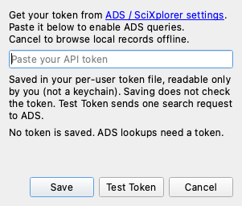
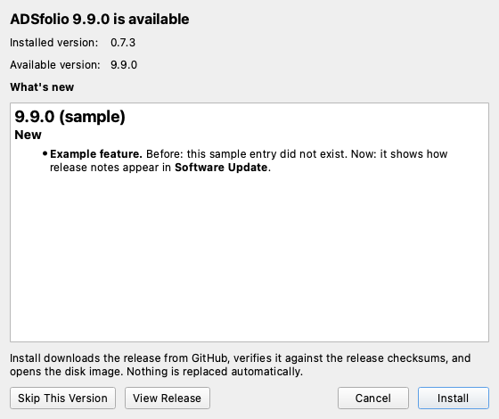
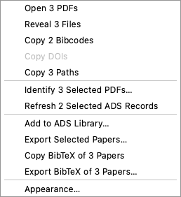
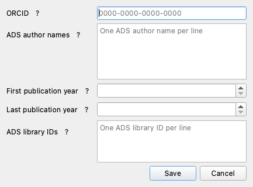
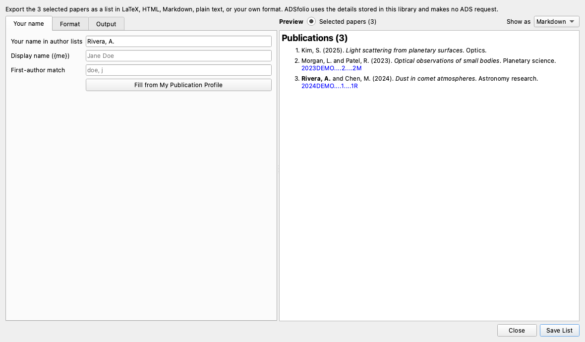

# App GUI guide

[Install ADSfolio](getting-started.md#install), then open it from your applications.
The download includes Python and the application dependencies.
ADSfolio provides a graphical desktop application to browse, catalog,
and organize scientific PDF libraries.

For a development checkout, run:

```sh
uv sync --all-extras
uv run adsfolio-gui
```

Startup does not require an ADS token. You can browse and edit local libraries
offline. ADS operations request a token when needed.

**Tools → NASA ADS Token…** shows where the active token comes from: the
`ADS_API_TOKEN` environment variable or a token file path. **Save** stores the
token in a file that only your user account can read. Saving makes no network
request. **Test Token** sends one search request to ADS. It reports whether ADS
accepted the pasted token. If the field is empty, it reports the result for the
active token.



Identification supports ADS, Crossref, and DataCite in that default order.
Reorder or disable providers in the Identify dialog. Crossref and DataCite
look up exact DOIs without an ADS token. Title matching uses ADS.
OpenAlex and PMID/PubMed lookup are not supported.

The left pane lists library roots and filtered views. The middle pane shows a
searchable publication table. The right pane shows editable metadata for the
selected PDF.

## Version information and updates

Open **Help → About ADSfolio** to see the version, copyright, license links,
and installation type. On macOS, **About ADSfolio** appears in the application menu.
**Copy App Details** copies version and system information for a bug report.
It does not copy your library data or paths.

**App Update** in the toolbar opens **Software Update**. The round GitHub button
next to it opens the project page. A blue dot on **App Update**
means a newer stable release is available. **Help → Check for Updates…** opens the
same window and checks the latest stable GitHub release in the background.

Software Update shows the installed and available versions and the changelog
entries between them. It offers these buttons:



- **Install** (desktop downloads) downloads the release for your system from
  GitHub. It verifies the file against the release's `SHA256SUMS.txt` and saves
  it in your Downloads folder. Then it opens the disk image on macOS, or shows
  the archive in your file manager. ADSfolio does not replace anything
  automatically. Quit ADSfolio before you replace the application. **Cancel**
  stops a download and removes the partial file.
- **Copy Command** (Homebrew installations) copies `brew upgrade --cask adsfolio`.
- **Skip This Version** hides the dot and startup notice for that release.
  A newer release appears again.

Python and source installations show update instructions instead of **Install**.

The checksum detects damaged or incomplete downloads. It comes from the same
GitHub release, so it does not prove who published the file. On macOS, files
that ADSfolio downloads do not receive the quarantine flag that browsers add.
As a result, Gatekeeper may not prompt as it would for a browser download.

ADSfolio also checks once at startup by default. To disable this, use
**Help → Automatically Check for Updates**, or use the checkbox in About.
Startup checks show a notice only when a newer release is available.
They do not interrupt work when you are offline or already use the latest version.

GitHub receives your IP address and app version. Checks send no PDFs, library
metadata, or ADS credentials. ADSfolio does not install updates automatically.
Update checks do not change your metadata or history.

Use the update method for your installation:

- **Desktop download:** install the release for your operating system.
- **Homebrew:** run `brew upgrade --cask adsfolio`.
- **Python installation:** update the package or source checkout, then restart.
- **Local source launcher:** update its checkout, then restart ADSfolio.
  Its version label does not track individual source edits.
  A desktop installer or Homebrew upgrade replaces the source launcher.

The **Local source launcher** explanation appears only when the source launcher
sets `ADSFOLIO_SOURCE_LAUNCH=1`. Official desktop bundles show installation guidance
for their operating system instead. The About copyright shows `@ysBach`.

## Library roots and missing PDFs

Add a root from **File → Add Library Root…**, or from **Add PDF Folder…** on the
welcome page that appears while no library exists. The welcome page also offers
the optional ADS token and publication profile. It also lists the services that
ADSfolio contacts. Registration discovers PDFs immediately. When the selected
folder has subfolders, ADSfolio asks **Include Subfolders** or **This Folder
Only** (the default). When the folder has no subfolders, ADSfolio adds it
without a question.

To change the scope later:

1. If ADSfolio watches the root, stop the watcher. ADSfolio disables the
   **Include Subdirectories** checkbox while it watches that root.
2. Right-click the root under **LIBRARIES**.
3. Toggle **Include Subdirectories**. This saves the scan scope, but it does not
   rescan the current catalog immediately.
4. Press **Refresh** (**F5**) to scan the root with its updated
   **Include Subdirectories** setting.

Non-recursive discovery updates only top-level locations. Previously cataloged
nested files remain unchanged, including their missing status. To restore
existing nested files and discover new ones, enable **Include Subdirectories**
and press **F5**.

For citations without ADS records or PDFs, use **File → Local References…**.
That window imports BibTeX, accepts manual entries, links optional PDFs, and
exports ADS and external references together. It is independent of the selected
PDF root. See [Local references](local-references.md) for the complete flow.

The sidebar groups records by **ADS linked** and **Needs ADS lookup**.
These groups use the catalog's saved link status. A stored bibcode can exist
before the app links the file to its ADS record. Complete non-ADS metadata can
also appear under **Needs ADS lookup**. Metadata readiness is a separate state.
An ADS link alone does not prove that the PDF contains the correct paper.

The table and detail pane check for changed PDFs before they show verification.
A stored bibcode can remain visible after a PDF changes.
Status tooltips explain changed files, ADS links, and metadata readiness.
External references can be ready for renaming without an ADS link.

**All PDFs** includes current catalog locations. Queries exclude missing locations.
Press **F5** to reconcile files moved or removed outside ADSfolio.
Double-click a bibcode, arXiv ID, or filename to open its destination by default.
If you prefer single-click activation, choose it in **View → Appearance… → Applications**.
Use the context menu to reveal a file or copy an identifier.

Select several rows with **⌘**-click or **Shift**-click (**Ctrl** on Windows and
Linux), then right-click. Each action covers every selected row:

- **Open N PDFs** and **Reveal N Files** (one file manager window per folder).
- **Copy N Bibcodes**, **Copy N DOIs**, and **Copy N Paths** copy one value per
  line. Each copy omits rows without the value, and the tooltip gives the count.
- **Refresh N Selected ADS Records** refreshes each paper with a bibcode, one
  after another. **Update and Rename Selected by Identifier…** needs one row,
  because it asks for one identifier.
- **Add to ADS Library…** adds the selected papers.
- **Export Selected Papers…** writes them as a list (see below).



## Browsing files and editing metadata

The table loads records in pages to keep large libraries responsive. The status
bar reports the loaded and total counts. Scroll or use **File → Load Next Page**
to load another page.

Bibcode and arXiv columns link to ADS and arXiv, respectively. Double-click a
cell to open its link, or choose single-click activation in the Appearance
dialog. ADSfolio never treats a click that only selects or edits as activation.
If a link column is too narrow for its full value, it shows a compact branded
link badge. Its tooltip and accessible text keep the full value. The Filename
column follows the configured activation and action: open the PDF or reveal it
in the file manager.

Right-click the table header to:

- show or hide columns.
- show all columns.
- resize columns to their contents.
- restore the default column order.

**Added** appears immediately before **Modified**, and the default
sort places the most recently added files first.

The narrow, unlabeled resolution column shows a green dot for a successful ADS
match or complete, current external metadata. Its tooltip distinguishes ADS
linkage from metadata readiness. Click that header to group records needing
attention first.

Use **View → Appearance…** to:

- choose a fixed-width font and point size independently for each table column.
- configure right-pane metadata text.
- select ISO 8601 or any Python ``strftime`` timestamp format, for example
  ``%Y-%m-%d``. Month is lowercase ``%m``.

Use the toolbar **Refresh** button or **F5** after you add, edit, move, or
delete PDFs outside adsfolio. Refresh scans the selected root with its
**Include Subdirectories** setting. It runs locally in a background job. It
updates changed file facts and discovers new PDFs. It hides missing paths but
keeps their catalog history. **File → Reconcile File Facts…** runs the same scan.

Refresh preserves existing metadata and local edits. Moved files retain their
metadata when their filesystem identity matches. The status bar and job log
report added, modified, moved, restored, and missing counts. Refresh keeps
selection, search, and sort settings when the originating view is still active.
Watcher writes pause during the scan.

The toolbar **ADS Refresh ▾ → Look Up Stored Bibcodes…** repairs pending ADS
links. It uses cached records first and queries uncached bibcodes in batches.
It fills empty metadata fields and retains existing values, locks, and history.
PDFs stay in place.

Files with stale metadata, missing digests, or digest
mismatches need identification again. Select **Identify papers…**. Then select
**OK** to check stored bibcodes and identify the remaining papers. When all
required records are in the cache, you do not need an ADS token.

Other ADS Refresh actions refresh and rename the selected record, a manually
entered identifier, all stored bibcodes, or citation splits. They use saved Rename
settings. **Refresh and Rename All ADS Records…** also includes eligible pending
bibcodes. A local **Refresh/F5** reconciles file facts without querying ADS.

Hold **Shift** to scroll the table horizontally. Each mouse-wheel event moves
at most one tenth of the visible page. Smooth trackpad movement uses one tenth
of its pixel distance. The same speed applies over the table header and scrollbars.
Scrolling without Shift keeps its native behavior.

Permanent cleanup remains separate: **File → Remove Missing Registry Records…**
asks before removing missing catalog entries and never deletes files.

Drag metadata rows in the right pane to choose their order. ADSfolio
keeps the order the next time the app starts. **View → Appearance… → Details** also lets
you reorder rows and choose which ones appear. Click a value to copy it. The
tooltip and status-bar message report the copy without changing the row layout.

Appearance changes apply immediately to the main table and detail pane while
the dialog is open. **Cancel** restores the previous appearance. **OK** keeps
the live settings for normal configuration saving.

**View → Appearance… → Applications** controls:

- whether bibcode, arXiv, and filename cells activate on double-click (default)
  or single click.
- whether filename activation opens or reveals files.

It also accepts optional PDF-viewer and web-browser commands. Empty commands use
the operating system defaults.

Right-click a bibliographic field to edit it or change its lock. A lock
preserves that field through later ADS updates, including **Identify** and
explicit refresh. ADS replaces unlocked fields. File identity fields
(filename, full path, modified date, size, and SHA-256) and workflow-state fields
(status and identification time) remain read-only.

Long author lists show five names first and expand on demand. Long abstracts
start as a preview and expand inline with **Show more**.

ADSfolio hides upgrade and annotation-port audit fields by default. The default
order places bibstem, volume, and page at the end, because the bibcode encodes
that information. ADSfolio converts HTML display markup from ADS to plain text
in the table, detail pane, and generated filenames.

Use **Update from ADS…** in the detail pane to enter or correct the selected
file's Bibcode, DOI, or journal-volume-page coordinates. A DOI may be bare,
`DOI:`-prefixed, or an HTTP(S) `doi.org` / `dx.doi.org` link. ADSfolio does not
recognize other publisher URLs. ADSfolio uses a DOI exactly as typed (apart from
lower-casing). As a result, it keeps trailing punctuation or parentheses that
belong to the DOI. Remove any sentence punctuation that you pasted with the DOI.

**Update from ADS…** refreshes that file's unlocked ADS metadata, abstract, and
citation counts. When it finds a unique matching ADS record, it marks the file
resolved. It then renames the PDF with the selected global or library Rename
settings. If a Bibcode has no ADS match, the update clears the Bibcode. The
local file remains tracked as unresolved.

**Tools → Refresh Selected ADS Record** performs the same update with the
current Bibcode, including detailed citation splits. **Tools → Refresh All ADS
Records…** refreshes metadata and abstracts for every tracked file with each
returned Bibcode. It preserves locked fields. **Tools → Refresh All Citation
Splits…** is deliberately separate, because ADS's Metrics endpoint returns
refereed/non-refereed counts only per paper. It confirms the number of
individual requests before it starts. Selecting a row does not by itself send
an ADS request.

**Tools → My Publication Profile…** stores your ORCID, ADS author-name forms,
first/last publication years, and optional ADS library IDs. The ORCID field
accepts an iD or an `https://orcid.org/` link. It checks the iD's check digit
before saving.

These global fields define the publications fetched for profile
matching. The years do not reject PDFs by their publication year. Saving the
profile does not make a network request. To rebuild the cache, use
**Tools → Identify → Advanced options… → Refresh publication cache**.



## CV Generator

**Tools → CV Generator…** makes a publication list for your CV from your NASA
ADS records. It writes LaTeX, HTML, Markdown, plain text, or any other text
format that you design.

1. **Your publications:** the ADS query, ORCID iD, years, and your name.
   **Fill from My Publication Profile** copies them from your profile.
   ADSfolio highlights your name in each author list.
2. **Format:** choose a built-in LaTeX or Markdown style, or **Custom
   template**. For a template, choose a starting point (LaTeX, Markdown, HTML,
   or Plain text), then edit the header, section, entry, and footer text.
   **Highlight your name** sets the markup around your name, for example
   `\textbf{{{}}}` in LaTeX or `<b>{}</b>` in HTML.
3. **Preview:** **Sample papers** shows fictional papers and updates while you
   type, with no network request. **Look Up in ADS** shows your real
   publications. **Show as** shows the exact file text (**Source**), or the
   text as a reader sees it (**Markdown** or **HTML**). LaTeX shows as source.
4. **Save CV** looks up your publications and writes the output file.

Hover over any control or label for an explanation. **Split into
First-authored and Co-authored sections** controls the two sections. Disable it
for one list in the original order.

ADS lookups need a token. The window stores its settings in `cv.yaml` in the
ADSfolio configuration folder. `adsfolio cv generate` reads the same file, so
a terminal or script can repeat the run. **Save Settings As…** copies the
settings to another file. See the [CV reference](cv.md) for every template
placeholder.

### Export selected papers

Select papers in the table, then choose **Export Selected Papers…** from the
context menu or the **Tools** menu. The same window opens with the selected
papers in the preview. It uses the details stored in this library, so it needs
no ADS token and makes no network request. The export includes papers without
a bibcode. Their link uses the DOI when the paper has a stored DOI.

The first export starts from your CV template, or from the Markdown starting
point, as one list without a header. **Save List** writes the file. The window
keeps these settings in `cv-selection.yaml`, so they do not change your CV
settings.



## Custom citation styles

Edit custom citations from the exact menu command
``Tools -> Custom Citation Styles...``. Qt shows it as **Tools → Custom
Citation Styles…**. The editor manages the ordered list of styles:

1. Select **Add** to create a new style with the next available ``My bibcode N``
   name. Or select a style and choose **Duplicate**. **Duplicate** inserts a
   copy with a fresh ID and a unique ``Copy of <name>`` name.
2. Select a style and use **Rename** by editing its **Name** field. Then edit
   its template and author controls.
3. **Reorder** styles with **Move Up** and **Move Down**. **Delete** removes the
   selected style. An empty list is a valid case.
4. Select **Update Preview** to validate the current draft and render it. If
   you opened the editor with exactly one selected table record, the preview
   uses that record. Otherwise the preview uses a labeled built-in example.
   Preview changes only the preview. It does not change the saved style list or
   the running library view.
5. Select **Save** to validate the current draft and the complete style list.
   A valid save immediately replaces the generated table columns and detail
   rows. It also persists the styles in the GUI configuration. Select
   **Cancel** to close without applying or emitting the draft changes.

On **Save**, invalid syntax, fields, names, IDs, duplicate names/IDs, or author
settings show an error and keep the editor open. The editor identifies the
affected style. It focuses a control only when one exists (IDs have no editor
field).

For each saved style, adsfolio creates a computed table column and detail row
after **Bibcode** by default, in the order shown in the editor. Generated
table columns are display-only and are not sortable. Generated detail rows are
computed, read-only, and not lockable. They do not become ADS metadata fields.

Use **View → Appearance…** to reorder or hide generated columns and detail rows.
You can also set their optional table/detail font, size, and color there. Use
**OK** in the Appearance dialog to keep those live settings for configuration
saving. **Cancel** restores the prior appearance. New generated items are
visible by default. These appearance settings, the style definitions, and their
order persist the next time the application starts.

Click a non-empty generated table cell or detail value to copy its complete
rendered text. The table status bar or detail tooltip reports **Copied**. An
empty rendered value is inert and leaves the clipboard unchanged.

Missing metadata supplies an empty string for its placeholder. The template's
literal spaces and punctuation remain. Rendering preserves Unicode. Rendering
is local-only and uses the record already available in the catalog or selected
row. Editing, previewing, selecting, and copying a citation do not send an ADS
request. Custom citation text is not a filename and does not rename PDFs.

Use Python-style replacement fields from this complete reference. Write fields
exactly as shown. When you save, the editor rejects format specifiers,
conversions, attribute/item access, unknown fields, and unmatched braces.

| Field | Rendered value |
| --- | --- |
| ``{bibcode}`` | ADS Bibcode, unchanged. |
| ``{year}`` | Publication year. |
| ``{title}`` | The first title value, with ADS HTML display markup converted to plain text. |
| ``{first_author_surname}`` | Surname of the first author only. For ``Bach, Yoonsoo P.`` this is ``Bach``. |
| ``{first_author_initials}`` | First-author surname followed by given-name initials. For ``Bach, Yoonsoo P.`` this is ``BachYP``. |
| ``{authors}`` | The author list in the selected author format and separator. If the total exceeds **Max authors**, retain **Authors when truncated** leading authors and append the configured truncation suffix. |
| ``{authors_without_suffix}`` | The same rendered author list, but without the truncation suffix. |
| ``{journal}`` | The first ADS bibstem, falling back to ``pub`` only when bibstem is absent. |
| ``{bibstem}`` | The first ADS bibstem only. It has no fallback. |
| ``{pub}`` | ADS publication or journal text, rendered as plain text when ADS markup is present. |
| ``{volume}`` | Publication volume. |
| ``{page}`` | First page or article identifier. |
| ``{{`` and ``}}`` | Literal opening and closing braces. |

Missing values render as empty strings. Rendering preserves spaces,
punctuation, and Unicode. It does not append a ``.pdf`` extension. For example:

```text
{first_author_initials} ({year}) {bibstem}, {volume}, {page}
→ BachYP (2024) A&A, 123, 456
```

Empty names, templates, and IDs, invalid author settings, duplicate names/IDs,
and invalid template syntax keep the editor open and identify the affected
style. The editor focuses a control only when one exists. IDs have no editor
field.

The author controls apply only when the template uses ``{authors}`` or
``{authors_without_suffix}``:

- **Author format**: **Surname + initials** (for example ``BachYP``),
  **Surname only** (``Bach``), or **Last, First** (``Bach, Yoonsoo P.``).
- **Max authors**: the threshold. ADSfolio does not truncate a list at or below
  that count.
- **Authors when truncated**: how many leading authors remain above the threshold.
- **Author separator**: joins retained authors.
- **Truncation suffix**: ADSfolio appends it only to ``{authors}``, and only
  when truncation occurs.

For an author name without a comma, ADSfolio uses the last token as the surname.
It uses the preceding tokens as given names.

## Identify and Rename

**Tools → Identify** and **Tools → Rename** run the same CLI commands as the
terminal application, as subprocesses. Output streams to the log dock. After
completion, ADSfolio reloads catalog records so counts and metadata are fresh.
Rename shows a dry-run preview before it applies changes. The GUI does not
render PDFs itself.

**Identify…** opens a short explanation with **OK**, **Advanced options…**, and
**Cancel**. **OK** starts the lookup directly:

1. It checks pending stored bibcodes against the cache and ADS.
2. It then identifies PDFs that still need metadata.

The lookup retains locked fields and history. It can update unlocked
publication fields. Files keep their names and locations.

The bibcode step covers all tracked PDFs in the library, including tracked
subfolders. The identification step uses the library's subfolder setting and
retains the saved unresolved-folder exclusion. The prompt states these scopes
and the DOI provider order. View and search filters do not limit this library
check. The library's subfolder setting controls recursion. Saved evidence and
provider settings still apply.

If ADS needs a token, setup opens before the job starts. The result notice
shows ADS link counts and the next step. To rename PDFs, use **Rename…**
separately.

Adding a PDF folder offers the same prompt. The **Needs ADS lookup** view also
contains an **Identify papers…** button. Routine navigation does not open popups.

Select **Advanced options…** to open the full Identify dialog. This dialog
remembers reusable options after the app restarts. **All libraries** stores global
defaults and is the default selection. **This library only** stores portable
overrides in that library's catalog metadata. Switching the scope immediately
loads its values.

The **Identification priority** list contains every supported evidence source.
Check the sources to enable. Drag them, or use **Up** and **Down**, to set
their order.

Identification stops at the first unique validated ADS match. If a
candidate is missing, invalid, or ambiguous, Identify tries the next enabled
source. The recommended order checks filename and PDF metadata Bibcodes/DOIs
before first-page evidence, structured filenames, and title matching. Thus, for
an opaque filename such as `aa43983-22.pdf`, Identify continues to DOI
extraction from the PDF itself.

**Save Defaults** saves the reusable controls for the selected scope. It does
not run Identify or close the dialog. **Run Identify** uses the controls as
currently displayed, without saving them. Parser warnings and the optional AI
CSV are one-run inputs. **Refresh publication cache**, **Allow ADS fallback**,
and **Apply file moves** are one-run actions on purpose. They always reopen
disabled.

**Skip unresolved directory** excludes the configured unresolved destination
before hashing, metadata extraction, or ADS queries. Without a destination it
means `<library>/unresolved`. It is off by default. So Identify continues to
retry existing unresolved files unless you enable it.

Every non-obvious Identify and Rename row has a visible **?** button, a
tooltip, and an accessible description. Rename's filename-template help lists
all supported fields. It explains truncation, sanitization, and automatic `.pdf`.

For difficult files, Identify writes `unresolved.csv` and a prompt to the job
log. The CSV contains relative paths and first-page text. To use an external
AI service:

1. Review that text before you share it with an external AI service.
2. Ask for exact identifiers only.
3. Save the response as CSV.
4. Choose **AI CSV (this run)** in Identify.

The current importer verifies bibcodes and DOIs with ADS. It does not apply
AI-written title or author fields directly. Normal Identify still provides DOI
lookup through Crossref and DataCite, and ADS title matching.

Enable **Apply file moves** to return successfully identified files from the
unresolved subtree to the library root. Identify keeps their filenames. Rename
and **Identify & Rename** watcher actions also apply the configured filename
template. With Apply disabled, Identify reports a preview.

The unresolved directory is the configured Identify destination, or
`<library>/unresolved` by default. Recursive scanning must include those files,
and **Skip unresolved directory** must be off. Identify also returns previously
identified files in that scanned subtree, without repeating their ADS lookup.
Identify handles AI CSV matches in the same run.

**Update from ADS** and the ADS refresh actions labeled **Rename** rename
updated PDFs with the effective Rename settings. Files in the unresolved
subtree also return to the root in the same move. These actions rename other
PDFs within their current directory. Filenames use the refreshed metadata,
including any locally locked fields. These actions apply immediately and pause
the library watcher while they run.

These actions fetch optional detailed citation metrics after renaming. A
failed metrics request therefore does not leave successfully refreshed PDFs
waiting for a rename. Plain metadata edits do not move files. If a filename collision or
rename error occurs, ADSfolio retains the refreshed metadata. The job log
explains why the rename did not complete.

Rename preview and Apply use the same effective Identify destination for the
selected library. ADSfolio never overwrites existing destination files. The log
reports collisions, and the identified source stays in place. ADSfolio updates
file moves and catalog locations together, with rollback on catalog failure.
Automatic return applies only to an unresolved subtree inside the library root.
When you select an external folder as a root, ADSfolio infers no parent library.

## Adding identified PDFs to a remote ADS library

The GUI distinguishes two different kinds of library:

* A **local PDF library** is a registered filesystem root, added with
  **File → Add Library Root**, and backed by the local adsfolio catalog. Its
  records, paths, metadata, and workflow state remain local.
* A **remote ADS library** is an ADS/SciXplorer destination. This dialog's
  destination table shows it. It is not a filesystem root or a second local
  catalog.

This workflow never renames or moves PDFs. It never edits the local catalog,
local metadata, Rename settings, or watch state. The main window snapshots
local records before it opens the dialog. Network work runs in a worker outside
the GUI thread.

### Entry points and source scope

Use **Tools → Add to ADS Library…** or the table context menu's **Add to ADS
Library…** action. The action requires a current local PDF root. ADSfolio
disables the action while another command or ADS-library dialog is active.
From the context menu, if the clicked row is not part of the current selection,
that row becomes the sole selection before the dialog opens.

The source controls are:

* **Selected rows** snapshots the selected rows currently loaded in the table,
  in visual table order. ADSfolio disables it when the selection is empty.
* **All identified files in this local library** queries every resolved record
  in the current local catalog. It ignores the active search, virtual view,
  and table pagination. Currently visible rows do not limit it.

Only resolved records with a non-empty ADS Bibcode are eligible. The dialog
reports unresolved, missing-Bibcode, and otherwise ineligible records, but it
does not submit them. ADSfolio deduplicates eligible Bibcodes deterministically
in first-seen order. So duplicate local files do not produce duplicate
submissions. The source summary reports **Source files**, **Eligible unique
Bibcodes**, **Ineligible files**, and **Local duplicate Bibcodes**.

### Remote destinations and request safety

The destination table shows the ADS library's name, document count, public or
private visibility, and permission. Only `owner`, `admin`, and `write`
permissions are writable and selectable. Destinations with `read` or an
unknown permission remain visible for explanation, but the table disables them.

**Create Library…** requires a non-empty name. It accepts an optional
description and public/private choice. It creates an empty remote ADS library,
returns it to the destination table, and selects it. Creation never includes
pending Bibcodes and cannot silently add documents.

The request sequence is:

| User action | ADS operation | Mutation? |
| --- | --- | --- |
| Open the dialog or choose **Refresh** | List the user's ADS libraries | Read-only |
| Select a writable destination | Fetch all destination Bibcodes for duplicate preflight | Read-only |
| Accept **Create Library…** | Create the named empty ADS library | Creates an empty library. No documents |
| Confirm **Add to ADS Library** | Add missing Bibcodes in document-management requests | Document-add POST, only after confirmation |
| Choose **Retry Remaining** | Reconcile remote documents, then add only Bibcodes still absent | Read-only reconciliation first. Any add is an explicit retry action |

Selecting a destination normally completes a remote duplicate preflight. A
complete fetch shows the exact number already present. It also excludes those
Bibcodes from the add request. If the fetch fails, **Already present** is
**Unknown**. The warning and final confirmation explain that ADSfolio may
submit all eligible Bibcodes. No document-add POST occurs merely from opening
the dialog, changing scope, selecting a destination, or loading remote documents.

Before the first document-add request, one final confirmation shows:

- the destination name and permission.
- the eligible unique count.
- the exact already-present count, or **Unknown**.
- the ineligible-file count and local-duplicate count.
- the number to submit.

The POST starts only after an affirmative answer. The ADS/SciXplorer
document-management contract permits at most 2,000 Bibcodes per request. So
larger submissions use stable-order batches of no more than 2,000.

### Progress, cancellation, partial results, and retry

The add operation runs asynchronously and reports progress without blocking
the GUI. **Cancel** takes effect before the next add batch. A request already
in flight may finish. Closing the dialog requests the same cancellation. The
dialog waits for clean worker shutdown before it closes.

If processing stops part-way through, acknowledged batches remain acknowledged.
The result distinguishes these Bibcode groups:

* **Acknowledged** Bibcodes accepted by completed add requests.
* **Already present** Bibcodes excluded by preflight or learned from the
  terminal result.
* **Failed** Bibcodes rejected with an ADS-declared error.
* **Status unknown** Bibcodes from a timeout or connection failure after
  ADSfolio sent a request, because ADS may have accepted them.
* **Unattempted** Bibcodes whose later batch was never started.

The result also reports **Cancelled**, plus the local-duplicate and ineligible
source counts.

The operation stops after the first failed or status-unknown batch. ADSfolio
does not silently retry a failed batch. It does not undo acknowledged remote
additions. Use **Retry Remaining** to reconcile first. ADSfolio reloads every
remote destination Bibcode. Then it submits only the remainder still absent.

If that read-only reconciliation fails, the dialog warns that a raw retry may
resubmit Bibcodes with an uncertain server outcome. The dialog then requires a
second explicit confirmation before it allows the raw retry.

## Exporting a remote ADS library

1. Use **Tools → Export ADS Library…**.
2. Select a remote library and bibliography style.
3. Click **Export**.
4. After ADS finishes, choose the save location.

This works without adding a local PDF folder and includes libraries where you
have read permission. It exports the entire selected remote library,
independent of local table selections.

BibTeX (`.bib`) is the default. Other choices are BibTeX with abstracts, RIS
(`.ris`), EndNote, AASTeX, MNRAS, Icarus, Solar Physics, ADS tagged, ProCite,
RefWorks, and MEDLARS. Journal bibliography styles use `.tex`. The remaining
tagged formats use `.txt`. Formatting comes from ADS, including its default
journal macros and author limits. This export does not apply local edits to
PDF metadata or custom citation styles for the table.

Network work runs in the background. ADSfolio first loads all library pages.
It then sends ADS exports in batches, within the documented ADS limit of 2,000
records. ADSfolio checks each response against the requested Bibcodes before it
can save a file. Records in the complete file are in Bibcode order. Count
mismatches and missing export records produce an error instead of a partial
bibliography.

Library pagination is not a server-side snapshot. Avoid editing
the library's membership during export. See the
[ADS export service](https://github.com/adsabs/export_service) for format details.

An empty library produces no file. Cancelling the operation or Save dialog leaves
existing files intact. Saving uses an atomic replacement after any native
overwrite confirmation. This action does not change ADS library membership,
local PDFs, or the local catalog.

## Merging annotations from another edition

The same paper can exist as a preprint, a published version, or a duplicate.
When its annotations are in more than one of these files, use
**Tools → Merge Annotations…**.

1. Choose the canonical **target** PDF first.
2. Choose the **source** PDF second.

ADSfolio shows the source (left) and target (right) pages side by side. It
lists every annotation in the source, including links and popups.

For each annotation:

- Highlight, underline, strike-out, and squiggly marks: drag across the target
  words. If the source words occur exactly once in the target as the same run
  of words, ADSfolio outlines that spot. It also enables **Accept exact-text
  suggestion**. The same run means the same case, punctuation, and hyphenation.
  ADSfolio places nothing until you accept it. There is no approximate text
  matching.
- Notes, rectangles, circles, lines, and ink: click the target position of the
  annotation's top-left corner. ADSfolio moves the shape, but never resizes or
  rotates it. So the target page must have the same rotation as the source page.
- Any other type (free text, stamps, links, form fields, and so on): ADSfolio
  cannot copy it without approximation. You must waive each one individually
  with **Waive (do not copy)…**. ADSfolio does not copy popup windows, because
  their parent annotation carries the content.

ADSfolio copies colour, opacity, comments, author, subject, flags, border, and
the icon of a note with each annotation. **Save merged copy…** writes a new file
and refuses to overwrite an existing one.

Before writing, ADSfolio re-reads the copy. It checks every transferred
annotation and every annotation already in the target. If any check fails,
ADSfolio saves nothing. The original PDFs and the catalog do not change.
ADSfolio does not add the copy to the catalog automatically.

If any annotation is neither placed nor waived, the dialog says so. The result
is then a partial merge, not a full consolidation.

When you merge a source again into a copy that already holds a merge from that
source, ADSfolio skips annotations that are already present. A private key in each
copied annotation records them. If another program rewrites the annotation, the
annotation loses that key.

The feature needs PyMuPDF. Install it with `pip install "adsfolio[full]"`. The
desktop app includes it.

## Watching library roots

Each registered root has three independent controls in the **Tools** menu and
its sidebar context menu:

* **Watch Current Library** starts or stops a watcher for the current session.
  Starting creates a fresh baseline. So the watcher offers only PDFs created in
  or moved into the root afterward for processing. It does not reinterpret
  existing PDFs as new arrivals, including files modified or renamed within the
  root.
* **Autowatch at Start** saves whether that root should start a fresh watch
  session the next time the GUI starts. Selecting the preference itself does not
  process anything.
* **Automatically Identify & Rename** authorizes future arrivals in an active
  watch session to make ADS requests and update the catalog. It also authorizes
  them to rename resolved PDFs and apply a configured unresolved-file move. It
  is off by default. When it is off, the non-modal notice bar offers
  **Identify & Rename** and **Dismiss** for each new arrival.

The watcher recognizes the ``.pdf`` suffix in any letter case, such as
``PAPER.PDF``. The watcher ignores a symbolic link to a PDF outside the root.
If a periodic scan cannot read a folder or file, it reports a watch failure and
leaves the tracked files unchanged. It does not mark them missing.

A ``●`` beside the root label marks the active watcher. You cannot change
recursive root scope until you stop that root's watcher. Foreground
**Identify** and **Rename** operations temporarily pause the root's worker
catalog writes. Filesystem arrivals continue to queue meanwhile. After
cancellation, failure, or completion, the operations resume the worker.

ADSfolio resolves Identify and Rename defaults independently. Each dialog's
**All libraries** choice supplies global defaults. **This library only** stores
and uses that root's catalog override. When no override exists, the global
settings are the fallback. A root can therefore use library-specific Rename
defaults and global Identify defaults, or the reverse.

Do not run a separate ``adsfolio pdf watch`` process or ``launchd`` watcher on a
root while the GUI watcher is active. Concurrent watchers can issue duplicate
ADS work and compete to rename or update the same PDF and catalog records.

While an identify, rename, or ADS refresh job runs, an indeterminate progress
indicator appears in the status bar. **Return** or **Enter** opens the selected PDF.
The keyboard navigation table below lists panel and Find shortcuts.

## Adjust the three panels

The Details panel uses compact rows by default. Values receive the space that
previously held drag handles and edit or lock buttons.

- Right-click a field or value to copy, edit, lock, or unlock it. Press F2 to edit a focused field.
- Drag a field label to reorder it. The context menu also offers keyboard controls.
- Drag the label/value divider to resize the shared label column. Double-click it to reset the width.
- A compact lock marker shows protected fields. An edit alone does not protect a field from an ADS update.
- In **View → Appearance… → Details**, disable compact rows to restore optional inline buttons.

The saved row order, hidden fields, fonts, and metadata locks remain active.
The abstract keeps its **Show more / Show less** control.

The sidebar uses **ADS linked** and **Needs ADS lookup** for saved link states.
A pending link can still have a bibcode or complete metadata. Use
**ADS Refresh → Look Up Stored Bibcodes…** to repair eligible pending links.
The amber triangle means that the PDF changed and needs Identify again.

Right-click a main-table column heading to open **Appearance…** or change visible columns.
The sidebar uses less indentation. Hover over a truncated library name to see its full path.

## Keyboard navigation

Use **Command** on macOS and **Ctrl** on Windows or Linux for the shortcuts below.
The View menu shows the shortcuts available on your system.

| Action | Shortcut |
| --- | --- |
| Focus Find and select its query | Command/Ctrl+F |
| Show or hide the Find bar | Command/Ctrl+Shift+F |
| Clear Find and focus the table | Escape |
| Show or hide Libraries | Command/Ctrl+Shift+L |
| Show or hide Details | Command/Ctrl+Shift+D |
| Show or hide the job log | Command/Ctrl+Shift+J |
| Reconcile local files | F5 or the system Refresh shortcut |
| Open the Identify prompt | Command/Ctrl+Shift+I |
| Open Rename options | Command/Ctrl+Shift+R |

Hiding a panel keeps the selected PDF and current query.
Find restores its bar if the bar is hidden. Refresh updates local file facts.
ADS metadata updates remain separate actions.
