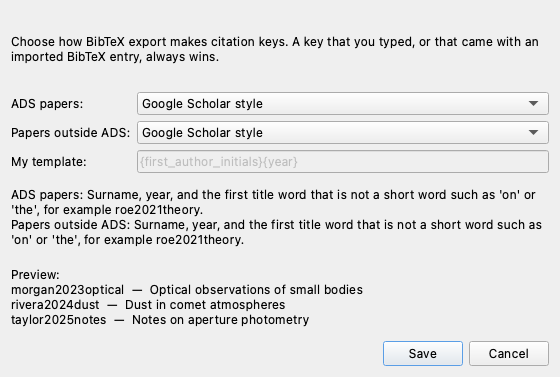
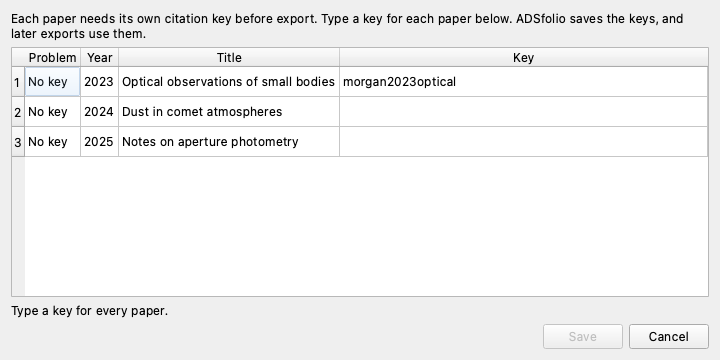

# My paper is not on ADS

ADS does not index every paper. ADSfolio also finds papers through Crossref,
DataCite, and arXiv. Choose the case that matches your paper:

- **You have the PDF, and you know its DOI or arXiv ID:**
  [Type the identifier](#type-the-doi-or-arxiv-id).
- **Many PDFs have a DOI inside them:**
  [Identify them with Crossref or DataCite](#identify-pdfs-by-their-doi).
- **It has no DOI, or you have no PDF:**
  [Add it as a local reference](#add-a-local-reference). Examples are a book,
  a thesis, and a citation from Google Scholar.

Then [export its BibTeX](#export-bibtex) with the citation key style that you
choose. None of these steps needs an ADS token. For the command line, see
[Tutorial 2](cli-tutorials/02-export-and-bibtex.md#8-references-outside-ads).

## Type the DOI or arXiv ID

Use this when one PDF in your library is not on ADS.

1. In the main table, select the PDF.
2. In the detail pane, choose **Update by ID…**. You can also
   right-click the row, or use **ADS → Update and Rename Selected by
   Identifier…**.
3. Type the DOI, for example `10.5555/jex.2019.12.34`, or the arXiv ID, for
   example `2401.12345`. A `doi.org` link also works.
4. Choose **OK**.

ADSfolio asks ADS first. When ADS has no match, it asks Crossref and DataCite
in your provider order. For an arXiv ID, it uses the DataCite record of the
arXiv DOI, `10.48550/arXiv.<ID>`. The PDF then receives the title, the authors,
and the year, and ADSfolio renames it with your Rename settings. The status
column still shows that ADS has no record.

An arXiv ID needs **DataCite** in your metadata providers, because Crossref
does not have arXiv DOIs. When ADS adds the paper later, choose **Update by ID…** again. The PDF then receives its bibcode.

Check the identifier against the paper before you choose **OK**. ADSfolio uses
the DOI as you type it, apart from lowercase letters. Remove sentence
punctuation that you pasted with the DOI.

To identify only some PDFs with the usual strategies, select their rows,
right-click, and choose **Identify Selected PDFs…**.

## Identify PDFs by their DOI

1. Select the library, then choose **Identify**.
2. Choose **Advanced options…**.
3. In **Metadata providers**, clear **NASA/ADS**, or move **Crossref** and
   **DataCite** above it with **Up** and **Down**.
4. Choose **OK**.
5. Choose **Rename** to preview new filenames from the found metadata.

DOI lookup fills missing metadata and records its provider and file digest.
Existing metadata, manual edits, and catalog history remain intact.
**Reset recommended** restores the default order: NASA/ADS, Crossref, then
DataCite.

Extraction strategies decide where ADSfolio finds identifiers. Provider order
decides which service receives a DOI. These are separate settings.

## Export BibTeX

1. In the main table, select one or more PDFs. ADS papers and other papers can
   be in the same selection.
2. Right-click, then choose **Copy BibTeX** or **Export Selection As… → BibTeX**. You can also
   use **Tools → Export Selection As…** and choose **BibTeX**.

### Choose the citation keys

Open **Tools → Citation Keys…**. Choose one style for ADS papers and one style
for papers outside ADS. The preview shows the keys of the selected papers.

| Style | Example key |
| --- | --- |
| ADS bibcode (ADS papers only) | `2020ApJ...900....1K` |
| DOI | `10.5555/jex.2019.12.34` |
| My template | `RoeA2019`, from `{first_author_initials}{year}` |
| Google Scholar style | `roe2019grain` |
| Type each key | You type the key at export. |

The defaults are the bibcode for ADS papers and the DOI for other papers. The
Google Scholar style uses the surname, the year, and the first title word that
is not a short word such as "on" or "the". ADSfolio uses its own list of short
words. It is not Google's list.

A key that you typed, or that came with imported BibTeX, always wins over the
style.

### When papers need a key

Export stops when a paper has no key, or when two papers share a key. ADSfolio
then lists those papers.

1. Type a key for each listed paper.
2. Choose **Save**. Save stays off until every paper has its own key.

ADSfolio saves the keys, so the next export uses them. A metadata refresh keeps
them.

### Renaming a paper that is not on ADS

You can rename a PDF that has no ADS record. It needs a current title, authors,
a year, and external or manual provenance. The default filename omits the
bibcode when none exists. A custom template still uses the fields that you
specify.

The paper stays in **Needs ADS lookup**. That view uses the saved ADS lookup
status, so it includes papers with complete non-ADS metadata. The status
tooltip shows whether the metadata is ready for renaming.

### When the PDF file changes

If a PDF's contents change, ADSfolio keeps the stored metadata but marks it
stale. Stale metadata cannot authorize automatic renaming. **F5** reconciles
local file facts. Renaming also checks a known content digest.

Editing notes does not revalidate stale metadata. DOI lookup fills only blank
fields. It does not replace retained fields, so it does not clear this
safeguard. Review a changed PDF before you relink its metadata.

## Add a local reference

Open **File → Local References…**. Use it for a book, a thesis, a report, or a
paper that you found elsewhere. You can save a reference without a PDF, a DOI,
or an ADS token.

### Copy a citation from Google Scholar

1. In Google Scholar, choose **Cite → BibTeX** under the result, then copy the
   BibTeX text.
2. In ADSfolio, open **File → Local References…** and choose **Import BibTeX…**.
3. Paste the text and choose **Preview**.
4. Check the citation key and the title.
5. Choose **Add references**.

To import a saved `.bib` file, use **Open .bib…** in the import window.
ADSfolio uses the text that Google Scholar exports. It does not scrape Scholar.
See the [Google Scholar help page](https://scholar.google.com/intl/en/scholar/help.html#export).

### Add, edit, and export

- **Add manually…** saves a reference that you type in.
- **Edit…** changes the fields of the selected reference.
- **Attach PDF…** links an existing PDF without moving it.
- **Export selected…** and **Copy BibTeX** write the selected references.

The list also shows papers already identified through ADS, including papers
outside the selected PDF folder. You can export ADS and local references
together in one bibliography. The main table still shows PDFs only. A reference
without a PDF appears only in **Local References…**.

## What ADSfolio keeps

Each reference has a local ID, a citation key, and an optional ADS bibcode.
`Smith2025Report` is a citation key. ADSfolio never sends it to ADS as a
fabricated bibcode. A complete external reference remains a local reference
even when ADS cannot identify it.

Import keeps every bibliographic field, including fields that the editor does
not show. Import also keeps the source text as provenance. Export uses the
current edited fields. To change these fields, use **Edit…** in
**Local References…**. The PDF detail pane directs edits there, so that several
attachments keep the same bibliography data.

Export writes the same bibliography, not a byte-for-byte copy of the imported
file. Whitespace and formatting can change.

- ADSfolio expands BibTeX macros.
- Export includes required cross-reference parents.
- A missing dependency causes an error instead of an incomplete bibliography.
- Export checks the selected references before it replaces an output file.
  An error keeps the existing file.

Import and save require unique citation keys and DOI identities. Correct any
duplicates first. ADSfolio does not merge references automatically. A failed
batch import saves no entries from that batch.

## Limits

- **ADS fields:** local export uses stored metadata. ADS fields that ADSfolio
  never fetched are not available automatically.
- **ADS libraries:** **Export ADS Library…** is a separate remote operation.
  ADS library synchronization excludes local-only references.
- **Linking to ADS later:** a PDF that you updated by DOI receives its bibcode
  when ADS adds the paper and you update it again. For a local reference without a
  PDF, DOI lookup and linking to ADS are future steps.
- **Backups:** BibTeX does not keep attachment locations, local IDs, or import
  history. To keep them, back up the central catalog. Close ADSfolio before you
  copy the SQLite catalog, so that pending writes finish.

## Other reference managers

ADSfolio focuses on NASA ADS / SciXplorer research workflows. Its local
references fill gaps in ADS coverage. They cover intake, metadata correction,
optional PDF links, and mixed BibTeX export. ADSfolio does not add browser
capture, word-processor integration, or a cloud library.

[Zotero](https://www.zotero.org/support/quick_start_guide) and
[Mendeley](https://www.elsevier.com/products/mendeley) offer those broader
workflows. You can use one of them alongside ADSfolio, and exchange data through
`.bib` files.
