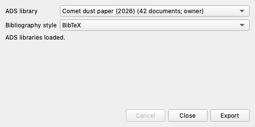
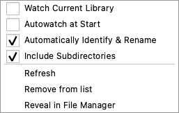
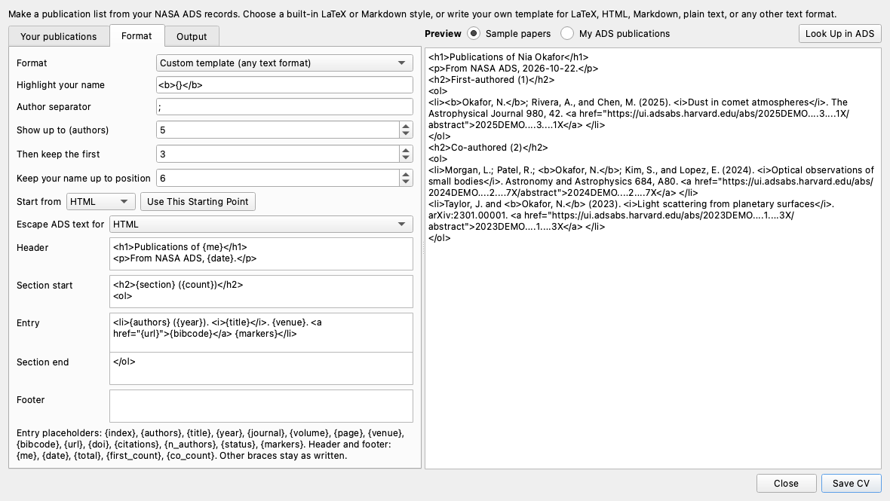

# Three everyday workflows

ADSfolio helps with three tasks that researchers repeat often:

1. [Keep a BibTeX file for your paper](#keep-a-bibtex-file-for-your-paper),
   for example in Overleaf.
2. [Watch a folder and rename new papers](#watch-a-folder-and-rename-new-papers)
   automatically.
3. [Make your CV from your publications](#make-your-cv-from-your-publications)
   in LaTeX, HTML, Markdown, plain text, or your own format.

<video controls muted playsinline preload="metadata" width="100%"
  poster="_static/tutorial/export-ads-library.png">
  <source src="_static/tutorial/workflows.mp4" type="video/mp4">
</video>

The 10-second video shows the three windows with fictional sample data.

## Keep a BibTeX file for your paper

Collect the papers you cite in a NASA ADS library. Then export that library as
BibTeX for LaTeX or Overleaf. ADS BibTeX uses the bibcode as the citation key,
for example `\cite{2024DEMO....1....1R}`.

1. Identify your PDFs. See [Start with your PDF library](getting-started.md).
2. Select papers, then choose **Tools → Add to ADS Library…**. Choose an
   existing ADS library or create one. ADSfolio adds papers to ADS libraries.
   It never removes papers from them.
3. Choose **Tools → Export ADS Library…**, select the library, keep
   **BibTeX**, and choose **Export**. Save the file, for example as
   `references.bib`.
4. Upload `references.bib` to your Overleaf project, or copy it next to your
   LaTeX file. Use `\bibliography{references}` in the document.



The export is a snapshot. Export again after you add papers. To keep the file
current automatically, run the library watcher in a terminal:

```bash
adsfolio library list                      # find the library ID
adsfolio library watch LIBRARY_ID -o references.bib -n 0 -t 60
```

`-n 0` repeats until you stop it, and `-t 60` checks the library every 60
seconds. The watcher writes `references.bib` when it starts and again each
time the library changes. Point `-o` at a folder that your LaTeX project reads, for example a
folder that you sync with Overleaf. See
[Tutorial 3: library workflows](cli-tutorials/03-library-workflows.md).

## Watch a folder and rename new papers

Let ADSfolio identify and rename each PDF that arrives in a folder, for example
the folder where your browser saves papers.

1. Add the folder with **Add PDF Folder…** or **File → Add Library Root…**.
2. Right-click the library under **LIBRARIES**.
3. Choose **Watch Current Library** to start watching now.
4. Choose **Automatically Identify & Rename** to process new PDFs without a
   question. Without this choice, a notice offers **Identify & Rename** for
   each new PDF.
5. Optional: choose **Autowatch at Start** to watch the folder each time
   ADSfolio opens.



Renames use the saved settings from the **Rename** window. Set the filename
template there first, and check it with **Preview**. Only PDFs that arrive
after watching starts are processed. Existing PDFs stay unchanged. A ``●``
beside the library name shows an active watcher. See
[Watching library roots](gui.md#watching-library-roots) for details. In a
terminal, `adsfolio pdf watch` does the same work.

## Make your CV from your publications

**Tools → CV Generator…** makes a publication list from your NASA ADS records.

1. **Your publications:** choose **Fill from My Publication Profile**, or type
   your ADS query, ORCID iD, and name.
2. **Format:** choose a built-in LaTeX or Markdown style, or **Custom
   template**. A template starts from LaTeX, Markdown, HTML, or Plain text.
   Then you control every part:
   - **Highlight your name:** the markup around your name, for example
     `\textbf{{{}}}`, `<b>{}</b>`, or `**{}**`.
   - **Entry:** the text for one publication, with placeholders such as
     `{authors}`, `{year}`, `{title}`, `{venue}`, `{bibcode}`, `{url}`, and
     `{citations}`.
   - **Header, section start, section end, and footer:** the text around the
     list, for example `<ol>` and `</ol>`.
3. Check the **Preview**. **Sample papers** updates while you type.
   **Look Up in ADS** shows your real publications.
4. Choose **Save CV**.



This entry template makes one LaTeX line per paper:

```latex
\item {authors} ({year}) ``{title},'' \textit{{venue}}. \href{{url}}{\texttt{{bibcode}}}
```

The settings live in `cv.yaml`. `adsfolio cv generate` reads the same file, so
a script can make the CV again. See the [CV reference](cv.md) for every option.
